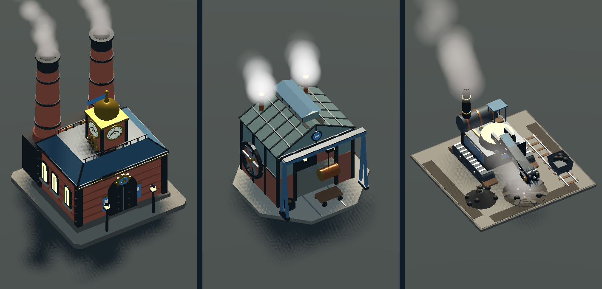
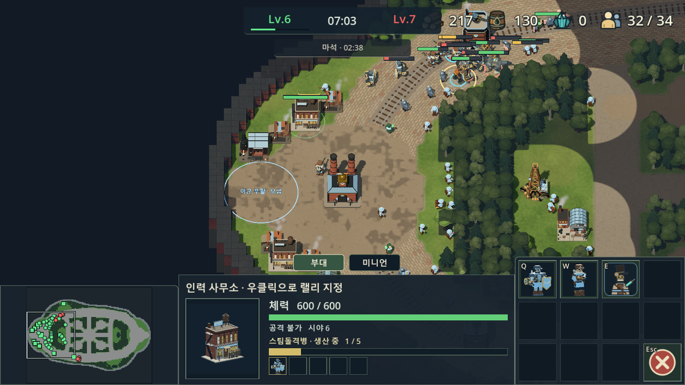
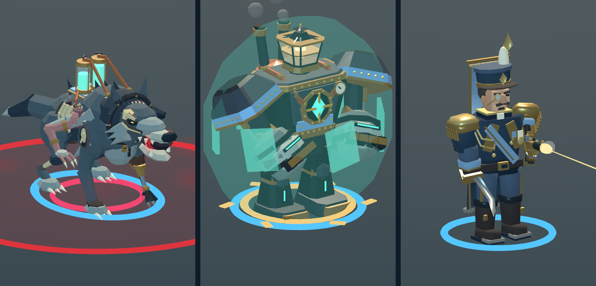
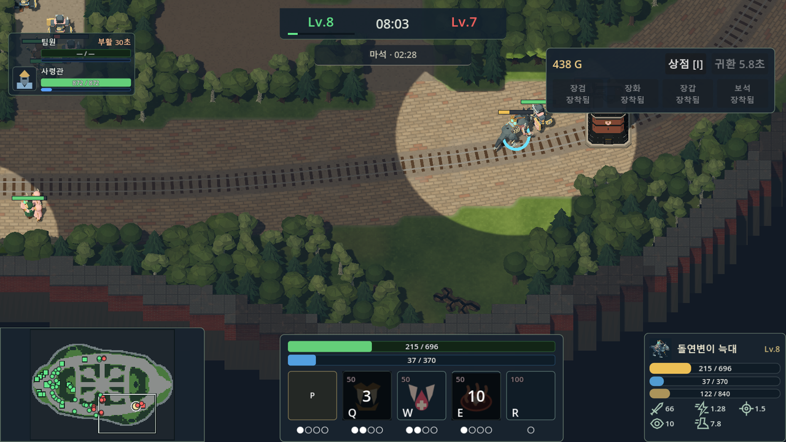
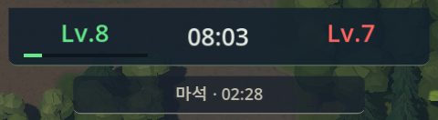
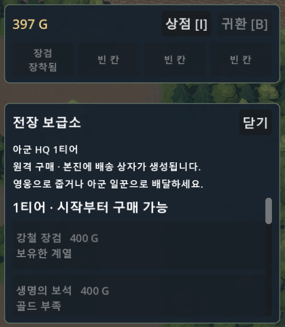

  

<h3 align="center">유전이 발견되었습니다. 인력을 투입하십시오.</h3>

  <b>RTS × MOBA</b> &nbsp;·&nbsp; <b>4 대 4</b> &nbsp;·&nbsp; <b>한국 · 미국 · 호주 · 독일 서버</b>

  

석탄 연기가 하늘을 덮은 공업 지구에서 용병 회사들이 서로의 본부를 두고 싸웁니다. 연료도 사람도 태워야 회사가 굴러갑니다.

한 팀은 4명입니다. **대표** 한 명이 전장을 내려다보며 회사를 굴리고, **용병** 셋이 라인 한가운데서 싸웁니다. RTS와 MOBA 장르가 맞물립니다.

> [!TIP]
> 아직 튜토리얼이 없습니다. 처음 할 때 알아 둘 것은 아래 [대표](#-대표)·[용병](#-용병) 칸에 짧게 적었습니다.
> 코드와 개발 문서는 대표를 지휘관(Commander), 용병을 영웅(Hero)이라고 부르고, 게임 안 연구 툴팁의 "용병"은 대표가 뽑은 병력을 뜻합니다.

<table>
  <tr>
    <td></td>
    <td></td>
  </tr>
</table>

## 🏭 대표

전장을 내려다보며 노동자를 부리는 RTS 자리입니다.

  
   HQ &nbsp;·&nbsp; 공장 &nbsp;·&nbsp; 석탄 시추기

- 노동자를 부려 나무를 베고 기름을 퍼 올립니다.
- 인력 사무소에서 일용직을, 공장에서 증기 병기를 찍어 냅니다.
- HQ를 업그레이드하면 석탄 시추기와 땅굴로 판을 넓힙니다.

  

오른쪽 위에 목재·기름·마석·인구가, 아래에 고른 건물과 명령 버튼이 있습니다. 버튼에 마우스를 올리면 비용과 하는 일이 나오고, 버튼 자리의 키(Q W E …)로 바로 누릅니다.
HQ 업그레이드는 2티어 건물과 함께 **용병들의 2티어 장비**도 엽니다.

## ⚔️ 용병

라인 한가운데서 스킬로 싸우는 MOBA 자리입니다.

  
   늑대 &nbsp;·&nbsp; 룬 골렘 &nbsp;·&nbsp; 사령관

- 셋 중 하나를 골라 라인에 섭니다.
- 레벨을 올리며 Q · W · E · R 스킬을 강화합니다.
- 마석을 차지해 공성추를 적 본진으로 보냅니다.

  

우클릭으로 움직이고 공격합니다. 아래 가운데에 체력·마나와 Q W E R 스킬, 오른쪽 위에 골드와 장비 칸이 있습니다.

### 팀 레벨

  

레벨은 용병 셋이 함께 씁니다(왼쪽이 우리 팀, 오른쪽이 상대 팀). 우리 용병 근처에서 적이 죽으면 팀 경험치가 오르고, 레벨이 오를 때마다 각자 스킬 강화 포인트를 하나씩 받습니다(스킬 위 `+` 버튼 또는 Ctrl+스킬 키).

### 골드와 장비

  

골드는 시간이 지나면 조금씩 들어오고, 적을 잡거나 금덩어리를 주우면 더 들어옵니다. 골드는 용병마다 따로 모읍니다. **I**로 상점을 열어 장비 4칸을 채우고, 부활 지점 밖에서 사면 본진에 상자가 떨어지니 직접 줍거나 대표의 일꾼에게 맡깁니다.

### 용병만 할 수 있는 것

맵 가운데의 **마석**과 정글몹이 떨어뜨리는 **금덩어리**는 용병만 우클릭으로 주울 수 있습니다. 줍는 동안 맞거나 다른 명령을 내리면 끊깁니다. 마석은 적 본진으로 공성추를 보내고, 금덩어리는 골드와 팀 경험치를 줍니다.

## 🤝 협력해 강해지세요

용병이 장비를 사면 부활 지점에 상자가 떨어지고, 대표가 싸우고 있는 용병에게 날라 줄 수 있습니다.

  

## 💎 강력한 마석을 차지하세요

맵 한가운데의 마석에 정신집중을 마치면 거대 기계가 적 본진으로 향합니다.

  

## 🔥 적의 HQ를 무너트리세요

적의 본사를 무너트리면 승리합니다.

  

<table>
  <tr>
    <td></td>
    <td></td>
  </tr>
</table>

## 🎮 플레이

- **한국, 미국, 호주, 독일 서버**에서 플레이할 수 있습니다.
- 빈자리는 AI가 채워서 혼자서도 한 판을 시작할 수 있습니다.

> [!NOTE]
> 개발 중인 게임입니다. 화면과 규칙은 계속 바뀝니다. 바뀐 내용은 [변경 이력](CHANGELOG.md)에 있습니다.

## 🛠️ 개발 기록

전투와 이동은 모두 서버가 계산합니다. 학습용 AI는 서버 게임을 여러 판 동시에 돌리므로, 한 틱의 계산량이 곧 학습 속도입니다. 아래 수치는 서버 저장소의 변경 이력(`project-w-server/CHANGELOG.md`)에 남긴 측정값입니다.

<b>1. 길찾기에 A*를 쓴 이유</b>

 

맵은 1m 칸 격자이고, 유닛은 이 격자 위에서 A*로 길을 찾습니다.

- **장애물이 경기 중에 바뀝니다.** 대표가 건물을 짓고, 건물이 부서지고, 일꾼이 나무를 벱니다. 건물 자리 판정과 같은 격자를 쓰므로 칸이 막히거나 열리면 다음 탐색에 바로 반영됩니다. 미리 만들어 두는 내비게이션 메시라면 그때마다 다시 구워야 합니다.
- **유닛마다 목적지가 다릅니다.** 일꾼은 각자 다른 나무로, 근접 유닛은 각자 받은 공격 자리로 갑니다. 목적지 하나를 두고 맵 전체를 채우는 흐름장(flow field)은 목적지 수만큼 만들어야 하지만, A*는 출발점에서 목표 쪽으로 뻗어 가며 필요한 칸만 훑습니다.
- **오목한 지형이 있습니다.** 본진을 두른 숲 벽처럼 목표 쪽으로 걷기만 하면 갇히는 곳이 있어, 지형 전체를 보고 돌아가는 경로가 필요합니다.

A*를 덜 돌리는 장치도 함께 둡니다.

- 직선으로 갈 수 있으면 A*를 건너뜁니다.
- 한 틱에 훑을 수 있는 칸 수에 예산(`pathNodeBudget`)을 둡니다.
- 경로는 무언가 **새로 막혔을 때만** 다시 계산합니다(`blockAddVersion`). 나무가 베이거나 건물이 부서져 길이 열리기만 할 때는 그대로 갑니다.
- 1초 넘게 막힌 유닛은 가까운 범위(`stuckDetourCells`) 안에서만 우회로를 찾습니다.

마지막 두 장치는 낭비를 재다가 생겼습니다. 막힌 유닛이 목표 지점에 서 있는 공격 대상의 몸까지 피하려다 닿을 수 없는 길을 찾느라, 맵의 빈 칸 약 7천 칸을 모두 뒤진 뒤에야 포기하고 있었습니다. 이제 대상의 몸은 피하지 않고, 우회로를 못 찾으면 지형만 본 원래 경로로 돌아갑니다.

| 봇 6명 15분 경기, 3판씩 | 이전 | 이후 |
| --- | --- | --- |
| A*가 훑은 칸 (분당) | 약 14.6만 | 약 7.1만 (−51%) |
| 한 틱 최대치 (예산 `pathNodeBudget` 2만) | 1.8~2.2만 | 0.9~1.4만 |

<b>2. 근접 공격을 자리(슬롯) 방식으로 바꾼 이유</b>

 

처음에는 근접 유닛이 모두 대상 중심으로 직진하다가 서로 부딪히면 옆으로 비켜 돌았습니다. 대상 둘레가 다 차면 남은 유닛이 뒤에서 계속 밀며 맴돌았고, 벽을 등진 대상 앞에서는 서로의 몸을 파고들었습니다. 화면에는 몸이 겹친 채 쉬지 않고 꿈틀대는 덩어리로 보였고, 서버는 때리지도 못하는 유닛의 이동과 충돌을 매 틱 계산했습니다.

이제 대상 둘레에 공격 자리를 나눠 줍니다.

- 근접 유닛은 받은 자리로 가서 때립니다. 자리가 없으면 한 줄 바깥의 **대기 원**에 서 있다가 자리가 나면 들어갑니다.
- 근접 영웅은 둘레가 다 차 있어도 자리를 받고, 미니언이 비켜 줍니다.
- 건물은 사거리만큼 떨어진, 모서리가 둥근 사각형 둘레에 자리를 나눕니다.
- 스스로 대상을 고르는 유닛(공격 이동·라인 미니언)은 둘레가 다 찬 적보다 자리가 남은 적을 먼저 고릅니다. 처음에는 기다리던 유닛을 다른 적으로 옮기기만 했더니, 더 가까운 원래 대상으로 되돌아가 한 유닛이 10초에 41번까지 대상을 바꿨습니다.

| 장면 | 이전 | 이후 |
| --- | --- | --- |
| 근접 미니언 24기 → 골렘 1기: 사거리 밖 유닛의 이동 합 | 초당 23~39m | 0 |
| 〃 몸 겹침 합 | 1.3~6.7m | 0 |
| 〃 둘레를 다 채우는 시간 | 4초 | 3초 |
| 〃 동시에 때리는 수 | 12 | 13 |
| 골렘 옆 9m에 적 미니언을 하나 더 둘 때 | 12기가 때리고 12기가 맴돎 | 23기가 두 대상을 나눠 침 |
| 근접 미니언 48기 → 건물 1채: 14초 뒤 이동 합 | 초당 약 100m | 0 (7초부터) |
| 〃 겹친 쌍 | 8~32 | 0 |
| 〃 24기가 모두 붙는 시간 | 10초 | 6초 |

자리를 나누는 계산이 더해져 시뮬레이션 계산 시간은 약 5% 늘었습니다.

<b>3. 타일링(공간 색인)을 쓴 이유와 줄어든 계산량</b>

 

유닛은 움직일 때마다 주변을 확인합니다. 다른 몸과 겹치지 않는지(`separation`), 앞을 막는 유닛이 있는지(`blockingUnit`), 가장 가까운 적이 누구인지(`nearestEnemy`)입니다. 처음에는 이 검사가 매번 맵의 모든 유닛을 돌았습니다. 유닛이 n기면 한 틱에 n×n번 비교하는 셈(O(n²))이라, 규칙 봇 20판의 CPU 중 `separation` 18%, `blockingUnit` 15%, 맵 순회 23%를 이 검사가 썼습니다. [시야 계산](docs/fog-of-war.md#성능-측정)을 고칠 때부터 다음 병목으로 적어 둔 곳이었습니다.

그래서 맵을 한 변 1.9m 타일로 나눠 유닛을 넣어 두고, 주변 타일만 봅니다.

- 타일 한 변(`2*approachPad + attackAvoidanceMargin`)은 가장 큰 두 몸이 공격 회피 여유까지 두고 닿는 거리 이상입니다. 그래서 겹침·막힘은 자기 타일을 둘러싼 3×3 타일만 봐도 빠짐없이 찾습니다.
- 가까운 적·포탑 대상·뒷문 호위는 사거리를 덮는 타일만 봅니다.
- 움직인 유닛은 그 자리에서 타일을 옮겨, 뒤에 움직이는 유닛이 바뀐 위치를 봅니다.
- 판정이 전체를 도는 방식과 같은지 무작위 배치 비교 테스트(`TestUnitIndexMatchesFullScan`)로 확인합니다.

| 규칙 봇 20판 (`GOMAXPROCS=4`, i7-6700K, 번갈아 3번씩 평균) | 전체 순회 | 타일 | 감소 |
| --- | --- | --- | --- |
| 벽시계 | 54.9초 | 30.1초 | −45% |
| CPU 시간 | 200초 | 108초 | −46% |
| 틱당 CPU | 약 0.43ms | 0.24ms | −44% |

같은 판 수를 거의 절반 시간에 돌리게 됐습니다. 이어서 오라·시야·나무 찾기도 거리부터 보도록 바꾸고 시야 제공자 타일을 8칸에서 16칸(`visionBucketCells`)으로 키워, 틱당 CPU를 0.262ms에서 0.237ms로 약 10% 더 줄였습니다(측정한 날 기계 부하가 달라 위 0.24ms와 직접 비교하지 않습니다).

---

  <a href="docs/development.md">개발 안내</a> &nbsp;·&nbsp;
  <a href="docs/art-direction.md">아트 디렉션</a> &nbsp;·&nbsp;
  <a href="CHANGELOG.md">변경 이력</a> &nbsp;·&nbsp;
  <a href="AGENTS.md">작업 규칙</a>

