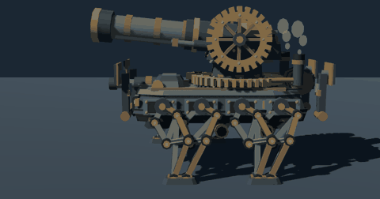
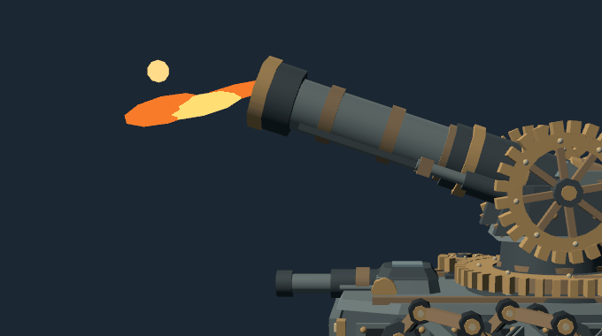
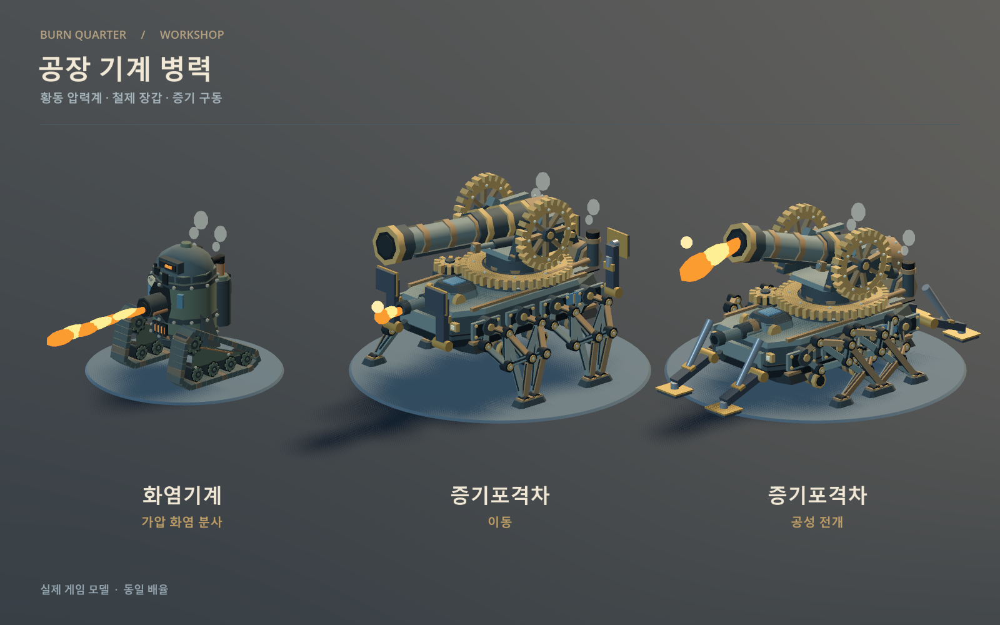
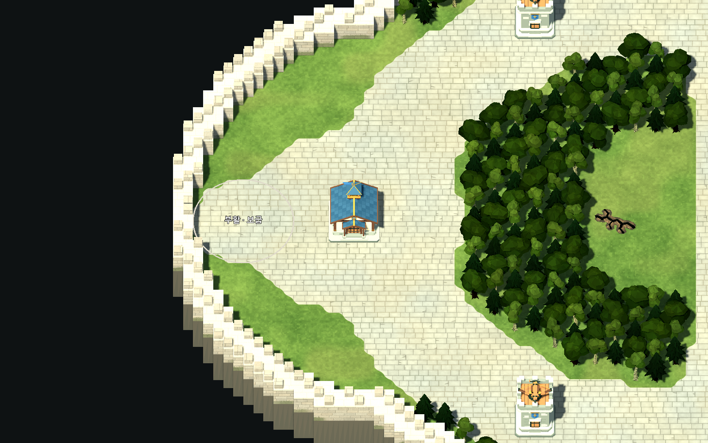

  

  <b>석탄 연기 아래에서, 회사는 사람을 땔감으로 쓴다.</b> 
  지휘관은 공장을 돌리고 영웅은 전선을 민다. 증기와 마법 공학으로 싸우는 3 대 3 전략 대전.

  

| 장르 | 인원 | 플랫폼 | 언어 | 상태 |
| --- | --- | --- | --- | --- |
| 실시간 전략 × AOS | 1~8명 (팀당 지휘관 1 + 영웅 3) | Windows | 한국어 | 개발 중 |

## 게임 소개

**번 쿼터(Burn Quarter)** 는 굴뚝과 증기 배관이 하늘을 덮은 공업 지구에서 벌어지는 용병 회사들의 전쟁입니다.

귀족 주주들의 금박 문장 아래에서 일꾼은 나무를 베고 기름을 퍼 올립니다. 번호표를 단 미니언은 줄지어 라인으로 걸어 나갑니다. 연료도 사람도 할당량만큼 태워야 회사가 굴러갑니다.

한 팀은 **지휘관 1명과 영웅 3명**입니다. 지휘관은 전장을 내려다보며 경제와 군대를 굴리는 RTS를 합니다. 영웅은 전장 한가운데서 스킬로 싸우는 AOS를 합니다. 같은 전장, 같은 시간에 두 장르가 맞물리고, 먼저 적 본진의 HQ를 무너뜨리는 쪽이 이깁니다.

## 주요 특징

### 지휘관: 회사를 굴리는 사람

- 일꾼으로 나무를 베고, 유전에 시추탑을 세워 기름을 퍼 올립니다.
- HQ를 2티어, 3티어로 올리면 공장과 기술연구소가 열립니다.
- 인력 사무소에서 스팀돌격병·공압사수·치유사를, 공장에서 화염기계와 증기포격차를 뽑습니다.
- 조병창에서 미니언과 용병을 강화하고, 라인마다 내보낼 미니언 편성을 직접 짭니다.

  

### 영웅: 전선을 미는 사람

- 돌연변이 늑대, 룬 골렘, 사령관, 레인저 중 하나를 골라 Q·W·E·R 스킬로 싸웁니다.
- 경험치는 팀이 함께 쌓아 공통 레벨을 올리고, 골드는 각자 모아 장비를 삽니다.
- 정글의 가시 멧돼지와 고목 수호자를 잡아 금덩어리를 챙깁니다.
- 중앙 광장의 공물을 차지하면 공성추가 적 본진을 향해 출발합니다.

  

### 증기 병기

증기포격차는 여덟 다리로 걸으며 차체의 소형 포탑을 쏩니다. 공성 모드로 바꾸면 앞뒤로 지지대를 박고 거포를 겨눕니다. 한 발 쏠 때마다 반동으로 포신이 뒤로 밀렸다가, 톱니가 돌며 제자리로 돌아옵니다.

<table>
  <tr>
    <td></td>
    <td></td>
  </tr>
  <tr>
    <td align="center">공성 전환: 지지대 전개</td>
    <td align="center">거포 포격: 반동과 톱니 복귀</td>
  </tr>
</table>

  

### 소모되는 사람들의 도시

스팀펑크와 마법 공학, 그리고 인명경시. 매드맥스, 필트오버와 자운, 프로스트펑크, 테란, 바이오쇼크 인피니트에서 영감을 받았습니다. 병기는 기름이 흐르도록 윤이 나지만 사람에게는 기름때와 잿가루가 앉아 있습니다.

<table>
  <tr>
    <td width="38%"></td>
    <td></td>
  </tr>
  <tr>
    <td align="center">HQ: 두 굴뚝과 금박 시계탑</td>
    <td align="center">HQ · 요새 · 감시탑</td>
  </tr>
</table>

### 혼자서도, AI와 함께

빈자리는 AI가 채웁니다. 혼자서 AI 7명과 한 판을 할 수도 있고, 강화학습으로 훈련 중인 AI끼리의 경기를 전체 맵으로 관전할 수도 있습니다.

## 스크린샷

<table>
  <tr>
    <td></td>
    <td></td>
  </tr>
  <tr>
    <td></td>
    <td></td>
  </tr>
</table>

## 개발 현황

> 개발 중인 게임입니다. 화면, 규칙, 수치는 계속 바뀝니다.

- 로비 매칭(최대 8명), 혼자 연습, 학습 AI 관전까지 플레이할 수 있습니다.
- 대전에는 별도의 게임 서버가 필요합니다. 서버와 AI 학습 저장소는 공개하지 않았습니다.
- 바뀐 내용은 [변경 이력](CHANGELOG.md)에 날짜순으로 적습니다.

## 개발자용

- [개발 안내](docs/development.md): 실행 방법, 폴더 구조, 코드 역할, 주제별 문서 목록
- [아트 디렉션](docs/art-direction.md): 세계관 레퍼런스와 재료·색·형태 기준
- [작업 규칙](AGENTS.md)
