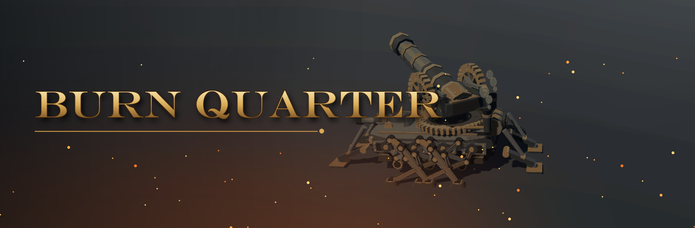
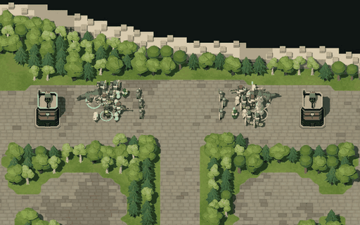
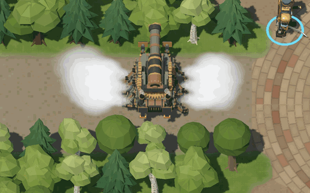
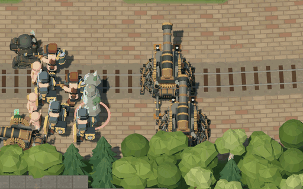
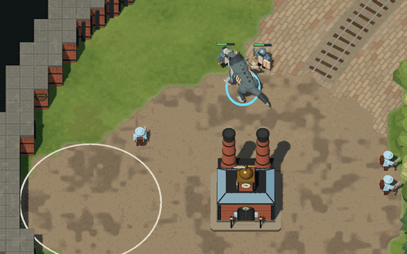
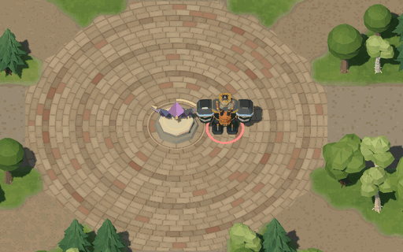
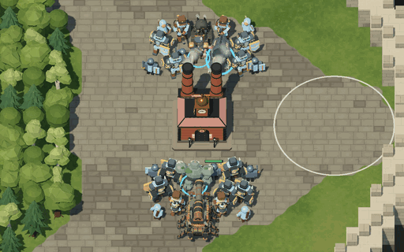

  

  <h2>유전이 발견되었습니다. 인력을 투입하십시오.</h2>

  

석탄 연기가 하늘을 덮은 공업 지구에서 용병 회사들이 서로의 본부를 두고 싸웁니다. 연료도 사람도 태워야 회사가 굴러갑니다.

한 팀은 4명입니다. **대표**는 전장을 내려다보며 노동자를 부리고 기름을 퍼 올려 증기 병기를 찍어 냅니다. **용병** 셋은 라인 한가운데서 스킬로 싸우고, 마석을 차지해 공성추를 적 본진으로 보냅니다. RTS와 MOBA 장르가 맞물립니다.

<table>
  <tr>
    <td></td>
    <td></td>
  </tr>
</table>

### 협력해 강해지세요

용병이 장비를 사면 부활 지점에 상자가 떨어지고, 대표가 싸우고 있는 용병에게 날라 줄수 있습니다.

  

### 강력한 마석을 차지하세요

맵 한가운데의 마석에 정신집중을 마치면 거대 기계가 적 본진으로 향합니다.

  

### 적의 HQ를 무너트리세요

적의 본사를 무너트리면 승리합니다.

  

<table>
  <tr>
    <td></td>
    <td></td>
  </tr>
</table>

- **한국 · 미국 서버**에서 플레이할 수 있습니다.
- 빈자리는 AI가 채워서 혼자서도 한 판을 시작할 수 있습니다.

> 개발 중인 게임입니다. 화면과 규칙은 계속 바뀝니다. 바뀐 내용은 [변경 이력](CHANGELOG.md)에 있습니다.

---

[개발 안내](docs/development.md) · [아트 디렉션](docs/art-direction.md) · [작업 규칙](AGENTS.md)
