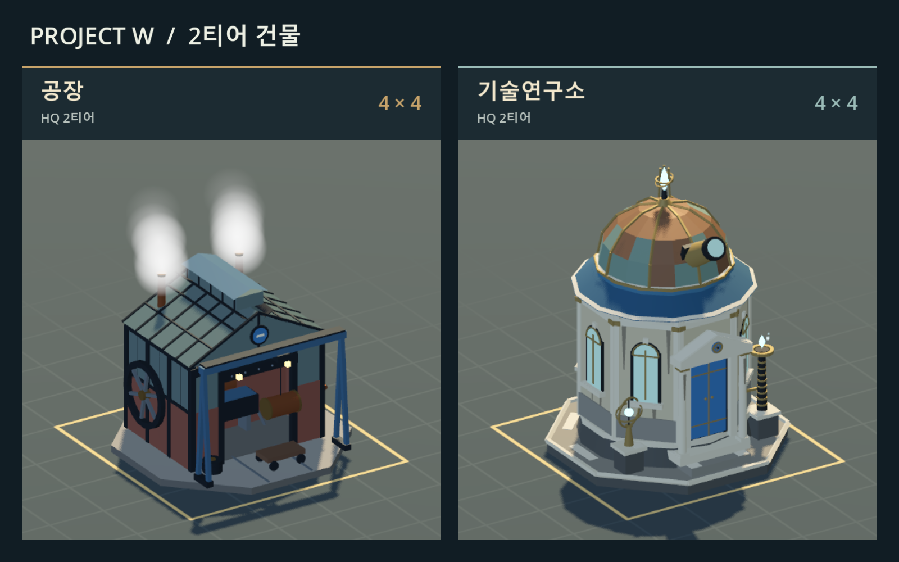
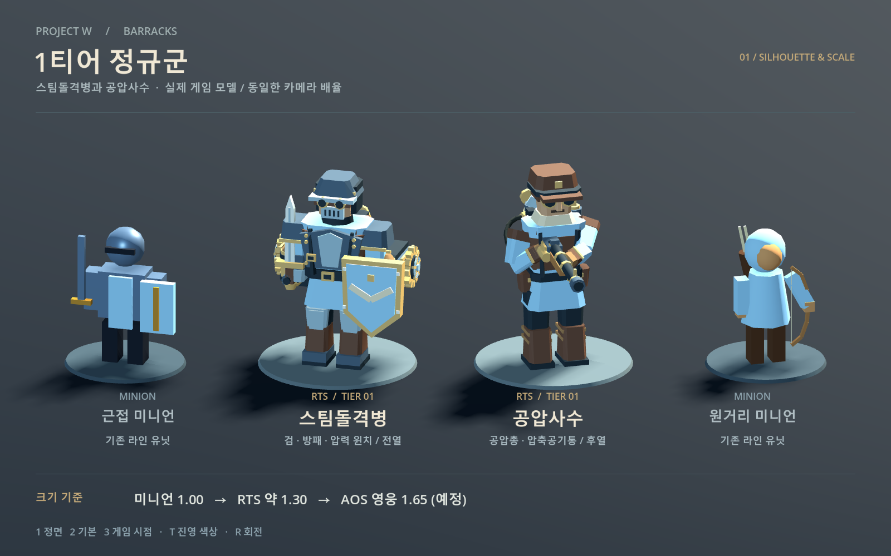

# 아트 디렉션: 증기, 마법 공학, 소모되는 사람들

배경·건물·유닛·효과가 한 세계에 속해 보이도록 정한 기준입니다. 새 모델을 만들거나 기존 모델을 고칠 때 이 문서를 먼저 확인합니다. 기준과 다르게 만들 이유가 있으면 이 문서를 같은 PR에서 고칩니다.

## 한 줄 컨셉

**스팀펑크 + 마법 공학 + 인명경시.** 각 진영은 귀족 가문이 세운 **기업 용병 단체**다. 본진은 회사 본사(HQ), 병력은 인력 사무소에서 하루 단위로 계약한 일용직이고, 회사 간판과 광고가 곧 군기와 선전이다. 석탄 증기와 결정 동력으로 돌아가는 밝지만 병든 변경 도시. 귀족 가문은 황금으로 치장한 병기를 아끼고, 그 병기를 굴리는 사람은 소모품으로 쓴다. 일하고 싸우는 사람과 짐승은 기름때와 잿가루를 뒤집어쓰고, 번호표를 달고, 대체 부품처럼 전장에 쏟아진다.

- **기술:** 1870~1890년대 산업 혁명의 증기 기관, 리벳 철판, 철도, 가스등에 **마법 공학**이 섞여 있다. 마법은 언제나 장치 안에 있다. 황동 틀에 끼운 결정, 유리관 속 빛, 기계에 새겨 동력을 받는 룬처럼, 배관·케이블·톱니로 기계와 연결되어 있다.
- **분위기:** 밝은 낮빛과 선명한 색이 기본이다. 디스토피아는 화면을 어둡게 해서가 아니라, 탁한 연기와 잿가루, 생명체에 묻은 때, 화려한 귀족 장식과 지친 일꾼의 대비로 드러낸다.
- **대비:** 탁한 연기·잿가루·그을음 ↔ 귀족의 황금·광택·문장. 한 화면에 둘 다 있어야 한다.
- **피할 것:** 성곽 총안, 십자가 깃발, 반목조 오두막 같은 중세 마을 요소. 장치 없이 떠다니는 마법(맨손 마법진, 공중에 뜬 돌, 자연에서 자라는 수정). 네온과 전자 화면 같은 사이버펑크.

## 레퍼런스: 무엇을 가져오나

장면이나 디자인을 베끼지 않는다. 각 작품에서 아래 감각만 가져온다.

| 레퍼런스 | 가져올 것 |
|---|---|
| 아케인의 필트오버 | 귀족 도시의 금박과 광택, 마법 결정을 기술로 다루는 마법 공학 장치, 깔끔하고 밝은 상층 |
| 아케인의 자운 | 같은 도시의 아래층. 탁한 연기, 녹색·청록 화학 빛, 덕지덕지 고친 배관, 약물과 개조로 버티는 사람 |
| 매드맥스 | 고철을 용접해 만든 병기, 장식처럼 단 해골·가시·사슬, 기계를 숭배하고 사람을 연료처럼 쓰는 태도, 먼지와 햇빛 |
| 프로스트펑크 | 거대한 발전기 하나에 매달린 도시, 생존을 위해 법으로 정당화하는 비인간적 결정, 노동 교대·아동 노동·감시 같은 제도적 냉혹함, 굴뚝과 증기의 규모 |
| 스타크래프트 테란 | 버려도 되는 해병과 강화복, 투박하고 읽기 쉬운 군용 기계의 실루엣, 거대한 볼트·두꺼운 장갑판, RTS에서의 가독성 |
| 바이오쇼크 인피니티 | 하늘처럼 밝고 화사한 선전 도시, 애국 포스터와 금박 장식 뒤에 숨은 강제 노동과 차별, 사람을 개조한 기계 병기 |

공통으로 가져오는 것: **밝고 화려한 겉면 아래에서 사람이 값싸게 소모되는 느낌.**

## 인명경시: 사람은 소모품, 병기는 보물

세계관의 냉혹함은 잔혹한 장면이 아니라 **사람과 기계를 대하는 차이**로 보여 준다. 피·절단·시체 같은 고어는 쓰지 않는다.

- **병기는 아낀다:** 기계에는 금박 문장, 일련번호 명판, 닦아 낸 광택, 정비공이 매달려 있다. 기계가 부서지면 크게 폭발하고 파편이 튄다.
- **사람은 갈아 끼운다:** 병사와 미니언은 스텐실로 찍은 번호표, 짝이 안 맞는 장비, 기워 입은 제복. 죽으면 짧게 쓰러지고 금방 사라진다. 같은 얼굴이 대량 생산된 듯 반복된다.
- **기계에 묶인 사람:** 일꾼은 방독면과 족쇄 같은 안전줄, 등에 연결된 배관. 기계 유닛 위에는 보일러에 석탄을 퍼 넣는 화부가 매달려 있다.
- **개조:** 산업 재해를 의수·의족·호흡기로 때운 병사와 일꾼. 귀족은 금으로 장식한 정교한 의수, 노동자는 고철 의수.
- **제도:** 징병소, 배급표, 감시 탐조등, 선전 포스터와 확성기, 귀족 문장이 찍힌 노동 계약서 같은 소품으로 "이게 당연한 도시"임을 보여 준다.
- **선전:** HQ와 인력 사무소 벽에 진영색 포스터와 구호 현수막. 밝고 영웅적인 그림체일수록 아래 현실과 대비가 커진다.
- **짐승도 도구:** 정글 짐승은 사냥되고, 일부는 마구와 재갈, 실험 장치를 단 채로 풀려난 것이다.

## 질감 규칙: 윤기 나는 병기, 때 묻은 생명

| 대상 | 표면 | 만드는 법 |
|---|---|---|
| **병기·기계** (화염기계, 증기포격차, 포탑, 공성추, 골렘의 몸체) | 윤기가 흐른다. 닦아 낸 황동, 옻칠한 철판, 금박 장식 | 금속성 0.6~0.9, 거칠기 0.2~0.4. 모서리와 리벳에 밝은 하이라이트. 때는 배기구·포구·바퀴 주변에만 좁게 |
| **생체 유닛** (일꾼, 병사, 미니언, 영웅, 정글 짐승) | 천과 가죽, 피부에 기름때와 잿가루가 **듬성듬성** | 소매 끝, 무릎, 손, 얼굴 한쪽, 옷자락 아래에 어두운 얼룩 조각(정점 색이나 작은 재질 조각). 전체를 더럽히지 않는다. 금속 장비는 병기보다 덜 닦인 상태 |
| **건물** | 벽돌과 철판은 그을음으로 위쪽이 어둡고, 귀족 시설의 장식은 반짝인다 | 굴뚝 주변과 지붕 끝에 그을음 그라데이션. 문장·시계·난간·돔은 금박 |
| **환경** | 탁한 연기 아래 밝은 땅 | 지면은 밝게 유지하고, 길과 공장 주변에만 잿빛과 석탄 가루를 깐다 |

때는 "듬성듬성"이 원칙이다. 한 유닛에서 얼룩이 표면의 10~20%를 넘지 않게 하고, 실루엣과 진영색을 가리지 않는다.

## 지금 상태: 무엇이 어긋나 있나

| 묶음 | 현재 인상 | 판단 |
|---|---|---|
| 2티어 기계(화염기계, 증기포격차) | 그을린 철판, 황동 톱니, 리벳, 증기 | **형태의 기준.** 광택과 금박을 조금 더 올리면 된다 |
| 1티어 병력(스팀돌격병, 공압사수) | 펠트 제복 + 황동 압력통 | 기준에 맞음. 때 얼룩만 더한다 |
| 사령관 영웅 | 19세기 장교 군복 | 귀족 장교. 금 견장·금줄을 더 화려하게 |
| 룬 골렘 | 룬과 청록 빛, 떠 있는 돌 조각 | 마법 공학으로 살릴 수 있다. 돌 대신 황동 틀과 리벳으로 감싼다 |
| 돌연변이 늑대 | 생체 괴수 | 연금술 실험체로 설명하면 맞는다 |
| 건물(HQ, 숙소, 인력 사무소, 브랜치, 조병창) | 파란 슬레이트 지붕의 반목조 오두막 | **가장 어긋남.** 중세 마을 |
| 요새, 감시탑 | 흰 석성과 총안, 십자가 깃발, 나무 감시탑 | 중세 성 |
| 공장, 기술연구소 | 오두막 + 기계 장식, 황동 돔 | 반쯤 맞음. 연구소는 마법 공학 시설로 키운다 |
| 지면과 외벽 | 톤을 낮춘 포석과 빛바랜 옛 포석 무리, 석재 성벽과 철띠로 보강한 어두운 옛 구간 | 아직 중세 도시 광장 쪽. 벽돌 포장·철판 방벽으로 더 옮긴다 |
| 미니언 | 단순한 블록형 인형 | 디테일 수준이 병력과 다름 |
| 정글 몬스터, 공성추 | 단순한 동물, 통나무 공성추 | 중세·민속 판타지 |

## 핵심 원칙

1. **작동이 보이는 기계.** 장식용 톱니를 붙이지 않는다. 톱니는 맞물리고, 굴뚝에는 연기가, 압력통에는 배관과 밸브가 이어진다. 마법 결정도 케이블이나 배관으로 어딘가에 동력을 보낸다.
2. **마법은 장치 안에.** 빛나는 것은 유리관·결정 함·룬 각인처럼 틀 안에 있고, 그 틀은 황동이나 철로 만든다. 빛은 틀 밖으로 크게 번지지 않는다.
3. **병기는 윤기, 생명은 때.** 위 질감 규칙을 따른다. 같은 화면에서 반짝이는 병기와 지친 병사가 대비되어야 한다.
4. **위에서 봐도 읽히는 실루엣.** RTS 카메라는 높이 비스듬히 내려다본다. 굴뚝, 크레인 팔, 탱크, 돔, 결정 첨탑 같은 높은 요소로 종류를 구분한다.
5. **팀색은 칠한 면에만.** 진영색은 천, 칠한 철판, 깃발, 차양, 문장 바탕에만 쓴다. 금속·벽돌·금박은 원래 색을 유지한다(`visuals/TeamMaterials.cs` 규칙).
6. **디테일은 크기에 비례.** 화면에서 작은 것일수록 단순하고 굵게. 미니언은 병력보다 단순하지만 같은 재료·색·때 규칙을 쓴다.

## 재료와 색

| 재료 | 기준 색 | 쓰는 곳 |
|---|---|---|
| 옻칠한 철 | `#2F363D` | 병기 몸체, 철판 벽. 광택 |
| 그을린 철 | `#3B434B` | 지지대, 산업 설비, 덜 닦인 장비 |
| 밝은 강철 | `#8F979C` | 피스톤 봉, 레일, 볼트 머리 |
| 황동 | `#A88349` | 톱니, 띠, 압력계 테두리 |
| 귀족 금박 | `#D9AE45` | 문장, 시계판, 난간, 돔, 장교 장식. 광택 높음 |
| 구리 | `#B0673E` | 배관, 보일러 덮개, 증류기 |
| 붉은 벽돌 | `#8A4A3A` | 건물 벽, 굴뚝, 외벽 |
| 그을린 목재 | `#5A4232` | 비계, 상자, 통, 시추탑 |
| 캔버스·가죽 | `#B9A784` / `#6B4A33` | 차양, 천막, 멜빵 |
| 기름때·잿가루 | `#2A2622` / `#7D7A74` | 생체 유닛의 얼룩, 굴뚝 주변, 길 |

- **진영색:** 아군 `#8DBDE3`, 적군 `#E3A09B`(`TeamMaterials.FriendlyColor`/`EnemyColor`). 넓은 지붕 전체 대신 칠한 철판 띠·차양·깃발·문장 바탕처럼 면적을 줄인다. 위에서 볼 때 건물마다 한두 곳은 보여야 한다.
- **발광은 세 가지만:**
  - 용광로·보일러 불빛 `#FF8A3D` 계열: 기계 노심, 조병창, 포구
  - 가스등 `#FFD37A` 계열: 가로등, 창문, 시계판
  - 마법 공학 결정 `#5FE3D0` 계열(청록): 결정 함, 룬 각인, 연구소. 반드시 황동·유리 틀 안에서만
- **재질 범위:** 병기 금속은 금속성 0.6~0.9·거칠기 0.2~0.4, 산업 설비 금속은 금속성 0.3~0.6·거칠기 0.5~0.7, 벽돌·목재·천·가죽은 금속성 0·거칠기 0.8 이상.

## 분위기: 탁한 하늘 아래 밝은 땅

- **빛:** 밝은 오후 햇빛, 약간 따뜻한 색. 그림자는 선명하게 유지한다(가독성).
- **연기:** 본진 굴뚝과 공장에서 탁한 회갈색 연기가 계속 오른다. 맵 가장자리 위쪽에 옅은 연무층을 두되 전장 바닥은 가리지 않는다.
- **잿가루:** 하늘에서 아주 드물게 떨어지는 회색 입자, 바람에 날리는 그을음. 화면을 흐리게 할 만큼 많이 쓰지 않는다.
- **대비:** 귀족 시설(HQ, 연구소, 영웅 장식)은 금박과 광택으로 빛나고, 노동 시설(브랜치, 숙소, 시추탑)과 길은 그을음이 짙다.

## 형태 언어

쓰는 것:
- 리벳 철판, 볼트 플랜지, 철골 트러스, 아치형 철제 창틀
- 굴뚝과 증기 배출구, 압력계, 밸브 핸들, 배관 다발
- 크레인 팔, 도르래와 와이어, 톱니와 톱니 막대
- 황동 틀 속 결정, 유리관, 기계에 새긴 룬, 테슬라 코일 같은 방전 첨탑
- 귀족 문장, 금박 시계, 장식 난간, 월계수·사자 장식
- 나무 상자, 석탄 더미, 기름통, 레일과 짐수레, 가스등, 전신주

쓰지 않는 것:
- 성곽 총안, 십자가·종교 문양, 반목조 오두막, 초가·슬레이트 지붕
- 틀 없이 떠 있는 돌·수정, 맨손 마법진, 숲에서 자라는 결정
- 화면 장치, 네온, 매끈한 플라스틱 곡면

## 묶음별 기준

### 환경

- **지면:** 밝기는 유지한다. 크림색 포석을 밝은 벽돌 포장과 자갈길로 바꾸고, 라인 도로에는 철로 침목이나 바퀴 자국과 잿빛 먼지를 넣어 길이 읽히게 한다. 본진 바닥은 공장 부지처럼 다진 흙과 석탄 가루 얼룩.
- **외벽:** 흰 석성 대신 붉은 벽돌 방벽에 철판 띠와 철골 버팀대, 군데군데 금박 문장 방패. 위에서 볼 때 두께와 높이는 지금과 같게 유지한다.
- **숲:** 유지한다(자원이자 쟁탈 대상). 가장자리 일부에 벌목 흔적, 그루터기, 쌓인 통나무, 잎에 앉은 잿가루로 산업이 숲을 먹어 들어가는 느낌.
- **유전:** 균열 암반에 기름 웅덩이와 그을음 얼룩. 시추탑 주변 배관과 기름통.
- **소품:** 가스등, 전신주, 석탄 더미, 버려진 짐수레, 결정 가로등(청록)을 라인 가장자리에 띄엄띄엄. 이동 충돌과 시야에는 영향을 주지 않는 장식만.

### 건물

벽돌 또는 철판 몸체 + 함석·철판 지붕 + 굴뚝이나 배관이 기본이다. 귀족 시설은 금박 장식, 노동 시설은 그을음. 크기와 점유 영역(`buildingDefs[...].Size`)은 서버가 정하므로 바꾸지 않는다.

| 건물 | 지금 | 목표 |
|---|---|---|
| HQ | **적용 완료** ([미리보기](images/town-hall-preview.png)) | 금박 시계탑과 귀족 문장을 단 벽돌 본관, 뒤로 큰 굴뚝. 티어가 오를수록 굴뚝과 증기 탱크, 결정 첨탑이 늘어난다 |
| 요새 | **적용 완료** ([미리보기](images/fortress-preview.png)) | 리벳 철판 팔각 보루, 금박 방패, 진영색 흉벽, 배기관 연기, 증기 기관포 |
| 감시탑 (옛 망루) | **적용 완료** ([미리보기](images/tower-preview.png)) | 철골 격자 탑, 회전 탐조등, 소형 증기 기관포 |
| 숙소 | **적용 완료** ([미리보기](images/supply-preview.png)) | 낮고 허름한 판잣집. 녹슨 골함석, 천막 덧지붕, 판자 창, 불 피운 드럼통. 높은 인력 사무소와 실루엣으로 구분 |
| 인력 사무소 | **적용 완료** ([미리보기](images/barracks-preview.png)) | 대공황 시대 영미권 인력 사무소. 그을린 2층 벽돌 건물, 진영색 회사 간판, 옥상 구인 광고판과 목조 물탱크, 철제 비상계단, 문 앞에 줄 선 일용직 |
| 브랜치 (옛 보급기지) | **적용 완료** ([미리보기](images/store-preview.png)) | 밝은 물류 거점. 아연 아치 창고, 철골 하역 크레인, 철로와 화차. 검은 조병창과 색·실루엣으로 구분 |
| 조병창 (옛 대장간) | **적용 완료** ([미리보기](images/forge-preview.png)) | 검은 군수 공장. 리벳 철판 벽, 불꽃 튀는 증기 해머, 불티 뿜는 용광로, 쌓아 둔 포신 |
| 공장 | **적용 완료** ([미리보기](images/workshop-preview.png)) | 철골 유리 기계 조립동. 철골 유리 박공지붕과 채광탑, 조립 중인 보행 차체, 진영색 문형 크레인, 도는 플라이휠, 하얀 증기 |
| 기술연구소 | **적용 완료** ([미리보기](images/research-lab-preview.png)) | 고급스럽지만 먼지 쌓여 빛바랜 마법 공학 천문대. 석회암과 대리석, 녹청 낀 구리 돔, 금박 틀에 물린 청록 결정 첨탑, 테슬라 코일, 도는 혼천의 |
| 시추탑 | 목조 시추탑 | 유지. 배관과 기름통, 펌프 잭, 바닥의 기름 얼룩 |

### 유닛

- **크기 기준:** 미니언 1.0 → RTS 병력 약 1.3 → 영웅 약 1.65 → 기계 유닛 그 이상([1티어 정규군 미리보기](images/tier-one-units.png) 기준).
- **일꾼:** 작업복과 멜빵, 방독면이나 호흡기, 등의 공구 가방과 안전줄, 스텐실 번호표. 손·소매·바지 무릎에 기름때, 어깨에 잿가루. 일부는 고철 의수. 기름을 나를 때는 금속 통.
- **병사(스팀돌격병, 공압사수, 치유사):** 지금 모델 유지. 제복 소매 끝과 옷자락에 얼룩을 더하고, 장교급 장식(견장 금줄)만 반짝이게.
- **미니언:** 대량 징집병. 같은 얼굴, 번호표, 짝이 안 맞는 헬멧과 장갑, 병력보다 짙은 때. 같은 제복 색과 황동 포인트로 진영은 분명히 읽힌다. 치유 미니언은 의료 가방과 증기 분무기.
- **기계(화염기계, 증기포격차):** 지금 형태 유지. 철판 광택을 올리고 금박 문장판과 일련번호 명판을 더한다. 증기포격차 뒤에는 석탄을 퍼 넣는 화부를 매단다. 때는 배기구·포구·발 주변만.
- **공성추:** 통나무 대신 바퀴 달린 철제 증기 충각. 금박 사자 머리 충각, 뒤쪽 보일러.

### 영웅

- **사령관:** 귀족 장교. 금 견장, 금줄, 훈장을 지금보다 화려하게. 군복은 깨끗하되 장화와 망토 끝에 잿가루.
- **룬 골렘:** 마법 공학 골렘으로 정리한다. 떠 있는 돌 대신 리벳 철판과 황동 틀로 감싼 몸체, 가슴의 결정 노심(청록), 관절의 피스톤, 몸에 새긴 룬은 각인 홈 안에서만 빛난다. 몸체는 병기 규칙대로 윤기.
- **돌연변이 늑대:** 연금술 실험체. 몸에 박힌 약품관과 황동 고정쇠, 등의 약품 탱크. 털에는 기름때와 잿가루가 듬성듬성.
- **레인저:** 지금은 공압사수 모델을 키운 임시 모델이다. 결정 조준경을 단 장거리 공압 소총과 긴 외투를 입은 고유 모델이 필요하다.

### 정글 몬스터

도시 밖의 오염된 야생. 늑대·멧돼지는 기름과 잿가루에 찌든 짐승, 바위 괴물은 버려진 결정 기계에 엉겨 붙은 돌, 나무 괴물은 녹슨 보일러를 감싼 덩굴과 결정이 박힌 나무로 다시 그린다.

## 효과와 UI

- **증기:** 흰색~옅은 회색, 위로 퍼지며 사라진다(증기포격차 전환 증기 기준).
- **연기·잿가루:** 탁한 회갈색. 착지, 포격, 건물 파괴에 쓴다.
- **불:** 주황~노랑(화염기계 불꽃, 포구 화염 기준).
- **마법 공학:** 청록 결정 빛, 굵고 흰 방전 아크, 압축 공기 충격파. 효과는 장치(결정, 코일, 노심)에서 시작한다.
- **UI:** 지금의 어두운 남색 바탕 + 금색 테두리가 기준과 맞는다. 아이콘은 황동 판에 음각한 느낌, 귀족 장식은 금박으로 통일한다.

## 작업 순서 제안

1. **건물:** 가장 넓게 어긋나 있고 화면 면적이 크다. HQ → 생산 건물 → 요새·감시탑 순.
2. **지면, 외벽, 연기·잿가루 분위기:** 건물과 같이 바뀌어야 대비가 어색하지 않다.
3. **미니언과 공성추:** 라인에서 항상 보이므로 영웅보다 먼저.
4. **룬 골렘, 돌연변이 늑대 손질, 레인저 고유 모델, 사령관 장식.**
5. **기존 병력·기계에 질감 규칙 적용:** 생체 유닛 때 얼룩, 병기 광택과 금박.
6. **정글 몬스터와 환경 소품.**

각 단계는 모델만 바꾸고 점유 영역, 충돌 크기, 선택 원, 체력바 높이는 유지한다. 바뀐 모델은 기존 미리보기 장면으로 캡처해 해당 문서 이미지를 갱신한다.

## 새 모델 점검표

- [ ] 팔레트 안에서 만들었고, 발광은 불빛·가스등·결정 세 가지뿐이다.
- [ ] 병기는 윤기, 생체는 듬성듬성한 때(표면 10~20% 이하) 규칙을 따랐다.
- [ ] 마법 요소는 황동·유리·철 틀 안에 있다.
- [ ] 사람이 소모품이라는 느낌(번호표, 짝 안 맞는 장비, 기계에 묶인 사람, 선전물)이 한 가지 이상 있되, 고어는 없다.
- [ ] 진영색은 칠한 면(`team_cloth`, `banner`, `roof` 재질)에만 있고, 위에서 한두 곳 이상 보인다.
- [ ] 움직이는 부품은 실제로 움직이거나, 움직일 수 있는 구조로 보인다.
- [ ] 높은 카메라에서 실루엣만으로 종류를 구분할 수 있다.
- [ ] 중세(총안, 반목조, 십자가) 요소가 없다.
- [ ] 점유 영역·충돌·선택 원·체력바 높이를 바꾸지 않았다.
- [ ] 미리보기 이미지를 갱신했다.
