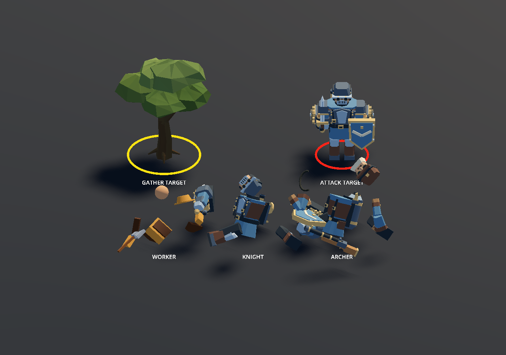

# 사망 연출과 명령 대상 표시

클라이언트만 변경하며 서버 메시지 형식과 게임 판정은 그대로 사용합니다.

## 사망

`REMOVE`를 받으면 유닛을 관리자 목록/선택/클릭 판정에서 즉시 제외하고 화면 모델만 남겨 사망 연출을 재생합니다. 서버는 유닛을 지우기만 하고, 연출은 클라이언트에서만 계산합니다.

- **사람(일꾼·스팀돌격병·공압사수):** 모델이 머리·팔·다리·몸통·들고 있던 무기나 도구 같은 자기 부품 단위로 떨어져 튕겨 나갑니다. 일꾼은 모자도 따로 날아갑니다. 잿빛 먼지가 잠깐 피어오르고, 부품은 한 번 둔하게 튀어 바닥에 미끄러진 뒤 1.25초(`UnitBreakupEffect.PersonSeconds`) 안에 흐려지며 사라집니다.
- **화염기계:** 몸체 위에서 불덩이가 터지고 검은 연기가 오르며, 머리·노즐·양쪽 궤도·바퀴가 사방으로 날아가고 몸체는 넘어집니다. 1.8초(`MachineSeconds`) 뒤 사라집니다.
- 피·상처·절단면은 그리지 않습니다. 블록 모델이 대량 생산된 인형처럼 부품째 흩어지는 것으로 "갈아 끼우는 사람"을 보여 주고([아트 디렉션](art-direction.md#인명경시-사람은-소모품-병기는-보물)), 기계는 더 크게 터져 대비를 만듭니다.
- 부품은 물리 몸체가 아니라 연출용으로 움직이며 클릭·충돌·시야에 영향을 주지 않습니다. 흩어지는 방향은 유닛 ID로 정해 매번 같습니다. 루트 위치는 그대로라 사망 위치도 변하지 않습니다.
- 그 밖의 유닛과, 분해 연출이 이미 16개(`MaxActive`) 진행 중일 때는 예전처럼 0.45초 동안 옆으로 넘어지고 0.15초 머문 뒤 0.45초 동안 흐려집니다. 큰 교전에서 화면이 부품으로 덮이지 않게 하기 위해서입니다. 시야 밖에서 죽은 유닛도 넘어지는 연출을 씁니다.
- 일꾼의 도끼질과 호흡은 사망 시작 때 정지합니다.
- 사망 중 추가 POS/STATE/REMOVE는 이동하거나 연출을 재시작하지 않습니다.
- 맵 초기화는 진행 중인 사망 연출까지 즉시 정리합니다.

넘어지는 연출은 `units/UnitDeathEffect.cs`, 부품 분해는 `units/UnitBreakupEffect.cs`(유닛별 부품 노드 목록), 게임 오브젝트 제외는 `UnitManager.HandleRemove`, 클릭 차단은 `Unit.BeginDeath`에서 처리합니다. 현재 REMOVE에는 제거 이유가 없으므로 접속 종료로 제거된 유닛도 같은 연출을 사용합니다. 타격과 사망 시점을 정밀하게 맞추는 서버 선딜 기능은 추가하지 않았습니다.

## 대상 원

`input/CommandTargetIndicator.cs`는 마지막으로 요청한 명령의 대상 한 곳을 표시합니다.

- 나무 우클릭/GATHER 요청: 노란 원.
- 적 우클릭 또는 A → 적 좌클릭/ATTACK 요청: 빨간 원.
- 원은 대상의 자식이므로 움직이는 적을 따라갑니다. 내 유닛의 초록 선택 원과 독립적입니다.
- 새 대상 명령, 이동 명령, 선택 변경, 대상 제거/나무 소진 시 이전 원을 지웁니다.

이는 클릭한 명령 대상에 대한 로컬 피드백입니다. 서버 승인 표시나 서버가 자동으로 다시 고른 모든 채집 대상을 표시하는 기능은 아닙니다.

## 확인

`previews/CombatFeedback.tscn`을 열고 F6을 누르면 세 유닛의 사망 연출이 반복됩니다. `-- --capture`로 실행하면 사망 0.525초 시점을 `docs/images/combat-feedback.png`에 저장합니다. 위쪽의 노란/빨간 원은 두 종류의 표시를 비교하는 독립적인 예시입니다.

명령 대상·사망 후 조종 제외는 `./tests/run.ps1 -Check UnitSceneChecks`, 사망·HIDE 후 위치 반영 중단은 `-Check InterpolationChecks`에서 확인합니다.
