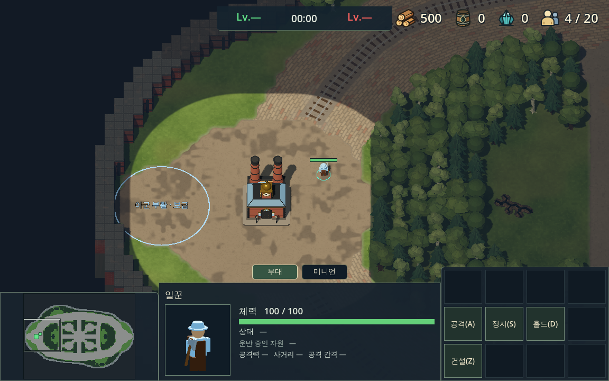
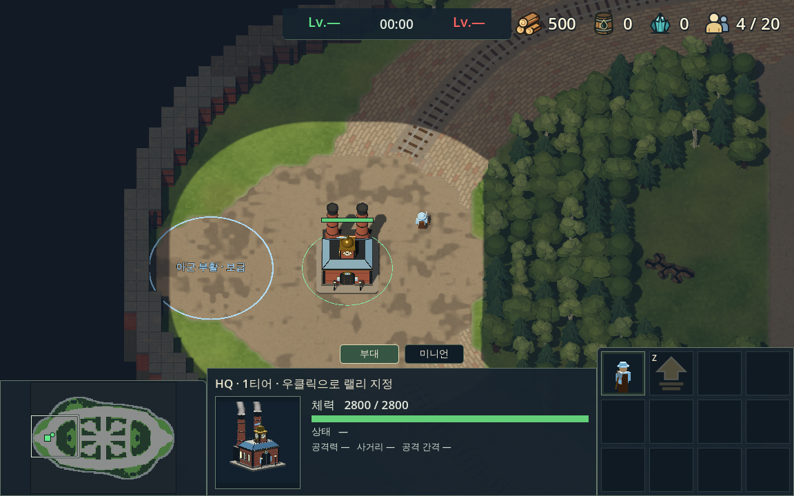
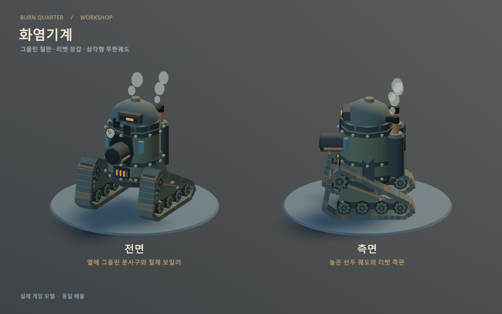
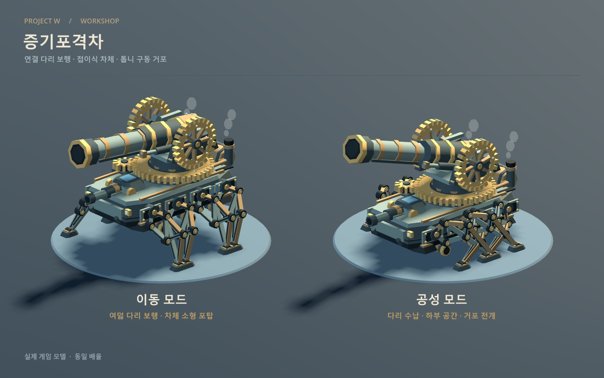

# 명령 패널

`game/Main.tscn`의 `SelectionUI/CommandPanel`에 286×216 크기의 패널을 화면 우측 하단에 붙여 표시합니다. 64×64 칸 12개가 한 줄에 네 칸씩 놓입니다.

- **그림 칸:** 칸에는 글자 대신 그림을 넣습니다. 생산·건설 버튼은 그 유닛·건물의 초상화(`ui/portraits/`, 돌팔이 의사·급유 기계는 `ui/icons/`), 명령·연구 버튼은 `ui/icons/`의 `command-*`·`research-*`·`siege-*` 아이콘입니다. 왼쪽 위 모서리에 그 버튼의 단축키, 아래 띠에 남은 시간이나 연구 단계 같은 짧은 상태를 표시하고, 이름과 비용·설명은 툴팁으로 봅니다. 쓸 수 없는 버튼은 그림을 흐리게 합니다(`ui/CommandSlot.cs`).
- **단축키 자리:** 버튼은 자기 단축키의 칸에 놓입니다. 단축키가 없는 HQ 일꾼은 윗줄 Q 칸에 두고, 칸이 없는 생산·건설 취소(Esc)는 비어 있는 오른쪽 아래(V) 칸에 둡니다. R 칸은 1티어 건설 메뉴의 감시탑이 쓰고, F 칸은 아직 비어 있습니다.
- **내부 번호:** 이 문서의 칸 번호는 명령의 내부 번호(노드 이름 `Slot7` 등)이며, 아래처럼 예전 넘패드 위치를 그대로 따릅니다.

```text
Q(7)  W(8)  E(9)  R(10)
A(4)  S(5)  D(6)  F(11)
Z(1)  X(2)  C(3)  V(12)
```

| 선택 | Q W E R | A S D F | Z X C V |
| --- | --- | --- | --- |
| 내 유닛 | — | 공격 · 정지 · 홀드 | 1티어 건설 · 2티어 건설(일꾼 포함 시) 또는 공성 전환(증기포격차 포함 시) |
| 1티어 건설 메뉴(Z) | 브랜치 · 숙소 · 시추탑 · 감시탑 | 인력 사무소 · 비허가 실험실 | 뒤로(C) |
| 2티어 건설 메뉴(X) | 석탄 시추기 · 땅굴 | 공장 · 기술연구소 | 뒤로(C) |
| HQ | 일꾼(단축키 없음) | — | 업그레이드(Z) · 생산 취소(Esc, V 칸) |
| 인력 사무소 | 스팀돌격병(Q) · 공압사수(W) · 돌팔이 의사(E) | — | 생산 취소(Esc, V 칸) |
| 공장 | 화염기계 · 증기포격차 · 급유 기계 | — | 생산 취소(Esc, V 칸) |
| 비허가 실험실 | 공격력 연구 · 체력 연구 | — | — |
| 기술연구소 | 와이어 돌진 | — | — |
| 땅굴 | 출구 설치(출구가 없을 때) | — | — |
| 공사 중인 내 건물 | — | — | 건설 취소(Esc, V 칸) |

- 조종 가능한 내 유닛을 선택하면 4번에 `공격(A)`, 5번에 `정지(S)`, 6번에 `홀드(D)`를 표시합니다. 여러 유닛을 선택해도 같습니다.
- 선택한 내 유닛 중 일꾼이 있으면 1번에 `1티어 건설(Z)`, 2번에 `2티어 건설(X)` 버튼을 표시합니다. 누르거나 Z/X를 누르면 아래 해당 건설 메뉴로 들어갑니다.
- 완성된 아군 HQ를 선택하면 7번에 `일꾼`, 1번에 다음 티어 `업그레이드(Z)`를 표시합니다. 업그레이드 툴팁은 서버가 보낸 목재·기름 비용과 시간을 표시하며, 조건 미수신·자원 부족·생산 대기열·업그레이드 진행 중에는 잠깁니다. 진행 중에는 아래 띠에 남은 초, 최고 티어에서는 `최고 단계`를 표시합니다.
- 완성된 아군 인력 사무소를 선택하면 7번(Q)에 `스팀돌격병`, 8번(W)에 `공압사수`, 9번(E)에 `돌팔이 의사`(아군 비허가 실험실 완공 필요)를 표시하고, 공장처럼 Q·W·E로 바로 생산합니다. 비용·인구·생산 시간은 서버 TRAIN_DEF를 받아 버튼 툴팁에 표시합니다.
- 본인이 예약한 유닛을 생산 중이면 3번에 `생산 취소(Esc)`를 표시합니다. 본인이 비용을 지불한 미완성 건물에는 같은 위치에 `건설 취소(Esc)`를 표시합니다.
- 선택이 없거나 조종할 수 없는 유닛, 적 HQ, 요새, 감시탑을 선택하면 모두 빈칸입니다. 기존 타입 1 요새는 건설 대상이 아닙니다.

`UnitManager`와 `BuildingManager`의 선택 변경 이벤트로 표시를 갱신합니다. 선택 대상이 제거되거나 소유권·팀이 변경될 때, 접속이 종료되거나 맵이 다시 동기화될 때도 반영합니다.

## 공격·정지·홀드

| 버튼/키 | 동작 |
| --- | --- |
| 공격 / A | 대상 지정 모드. 적 클릭은 공격, 지형 클릭은 공격 이동 |
| 정지 / S | 현재 작업을 중단하고 서버의 현재 위치에서 경계. 주변 적을 추격하고 복귀 |
| 홀드 / D | 현재 작업을 중단하고 위치 사수. 사거리 안의 보이는 적만 공격하고 추격하지 않음 |

정지와 홀드는 `STOP 유닛ID...`, `HOLD 유닛ID...`를 보냅니다. 클라이언트의 지연된 좌표로 MOVE를 만들지 않으며, 선택된 내 유닛을 최대 64개 한 번에 요청합니다. 입력은 기존 명령 큐와 동기화 검사를 거칩니다. 공격 대상 지정·건설 배치 중 S/D를 누르면 해당 모드도 종료합니다. 건설 메뉴가 열린 동안에는 메뉴에 채워진 칸의 키가 그 건물 선택을 우선합니다(1티어의 A/S는 인력 사무소/비허가 실험실, 2티어의 A/S는 공장/기술연구소). 빈 칸의 키는 메뉴를 그대로 둡니다.

서버는 이동·공격·채집·건설 명령을 교체하되 운반 자원, 공격 쿨다운, 공사 부지와 이미 지불한 비용은 유지합니다. 건설 중인 일꾼을 멈추면 다른 일꾼이 이어 지을 수 있습니다. 홀드 중에는 아군의 밀어내기로 이동하지 않으며, 새 이동·공격·채집·건설 명령으로 해제합니다. 대기 중에는 `STATE ... HOLD ...`, 실제 타격 중에는 기존 `ATTACK`을 표시합니다.

키보드는 카메라를 움직이지 않으므로 기본 명령 패널에서 S/D는 정지/홀드에 쓰입니다. 새 명령과 HOLD 상태를 받으려면 서버도 갱신하고 재시작해야 합니다.

## 건설 메뉴

일꾼을 선택하고 Z를 누르면 1티어, X를 누르면 2티어 건설 메뉴가 열립니다. 각 메뉴의 C/Esc는 기본 일꾼 패널로 돌아갑니다.

| 메뉴 | 번호 | 단축키 | 건물 | 서버 타입 | 상태 |
|---|---|---|---|---|---|
| 1티어(Z) | 7 | Q | 브랜치 (store) | 2 | 건설 가능 |
| 1티어(Z) | 8 | W | 숙소 (supply) | 3 | 건설 가능 |
| 1티어(Z) | 9 | E | 시추탑 (oil_derrick) | 7 | 유전 중심에 한 채씩 건설 |
| 1티어(Z) | 10 | R | 감시탑 (tower) | 6 | 아군 비허가 실험실 완공 필요 |
| 1티어(Z) | 4 | A | 인력 사무소 (barracks) | 4 | 건설 가능 |
| 1티어(Z) | 5 | S | 비허가 실험실 (forge) | 5 | 아군 인력 사무소 완공 필요 |
| 2티어(X) | 7 | Q | 석탄 시추기 (coal_drill) | 10 | 서버가 지정한 HQ 티어 완료 필요 |
| 2티어(X) | 8 | W | 땅굴 (tunnel) | 11 | 서버가 지정한 HQ 티어 완료 필요 |
| 2티어(X) | 4 | A | 공장 (workshop) | 8 | 서버가 지정한 HQ 티어 완료 필요 |
| 2티어(X) | 5 | S | 기술연구소 (research_lab) | 9 | 서버가 지정한 HQ 티어 완료, 아군 공장 완공 필요 |
| 둘 다 | 3 | C / Esc | 뒤로 | — | 기본 일꾼 패널로 복귀 |

잠긴 건물 버튼의 툴팁은 잠긴 이유와 건물 설명을 함께 보여 줍니다.

건물 버튼이나 단축키를 누르면 기본 패널로 돌아가며 반투명 배치 미리보기를 시작합니다. 전장을 클릭하면 `BUILD 건물타입 x z 일꾼ID`를 보냅니다. 점유 크기는 건물 씬과 배치 미리보기 정의를 따릅니다. 건설 비용과 가능 여부는 서버가 최종 판정하며 요청 시 클라이언트가 자원을 미리 차감하지 않습니다. 점유 검사와 취소 조작은 [건설 배치](../buildings/README.md#건설-배치)를 참고하세요.

인력 사무소·비허가 실험실은 가로 4칸·깊이 3칸, 공장은 4×4 부지를 사용합니다. 표시되는 배치 영역·완성 건물 선택 영역과 서버의 점유 크기를 함께 맞춥니다.

메뉴가 열려 있는 동안 A는 인력 사무소(1티어)나 공장(2티어) 선택에 사용합니다. 마우스 카메라 이동과 숫자 부대 지정은 유지합니다. 메뉴를 연 뒤 선택을 바꾸거나 부대 번호를 누르거나 창 포커스를 잃으면 기본 패널로 돌아갑니다. 반복 키 입력으로 같은 건물 요청이나 공격 모드가 중복 실행되지 않습니다.

시추탑은 유전 위로 마우스를 옮기면 중심에 맞춰집니다. 빈 땅이나 일반 도로에는 놓을 수 없고, 이미 공사 중이거나 완성된 건물이 있는 유전에도 중복 건설할 수 없습니다. 실제 건설은 일꾼이 도착한 뒤 서버가 다시 판정합니다. 완성된 아군 시추탑은 일꾼으로 우클릭하면 기름 채집·HQ 또는 브랜치 반납을 반복합니다. 시추탑에는 별도 생산 버튼이 없으며, 모은 기름은 HQ 업그레이드에 사용합니다.

석탄 시추기는 나무가 떨어진 뒤에도 쓸 수 있는 목재 채집지입니다. 완성된 아군 석탄 시추기를 일꾼으로 우클릭하면 `GATHER 시추기ID 일꾼ID...`를 보내고, 일꾼은 시추탑처럼 벽 옆에서 펌프를 밟아 목재를 날라 옵니다. 줄지 않으며 비용·작업 시간은 서버가 정합니다.

땅굴은 스타크래프트의 커널처럼 씁니다. 일꾼이 지은 땅굴이 완성되면 땅굴을 선택하고 Q(`출구 설치`)를 눌러, 같은 2×2 미리보기로 보이는 빈 땅을 클릭합니다. `TUNNEL_EXIT 땅굴ID x z`를 보내고 출구는 서버가 바로 세웁니다(추가 비용 없음, 시야 밖·막힌 자리는 서버가 `ERR`로 거절). 서버의 `TUNNEL_LINK`로 짝이 정해지면 버튼은 `연결됨`으로 잠기고, 선택한 내 유닛(지휘관 병력 또는 내 영웅)으로 아군 땅굴을 우클릭하면 `TUNNEL 땅굴ID 유닛ID...`를 보내 반대쪽 땅굴 옆으로 나옵니다. 출구가 없는 땅굴을 우클릭하면 그냥 걸어갑니다. 한쪽이 무너지면 다른 쪽도 함께 무너집니다.

공장과 기술연구소는 HQ 업그레이드가 완료되면 해금되는 건물입니다. 완공 공장에서는 Q로 화염기계, W로 증기포격차, E로 급유 기계(아군 기술연구소 완공 필요)를 생산합니다. 완공 기술연구소의 Q는 스팀돌격병의 자동 **와이어 돌진** 연구입니다.

## 선행 건물과 HQ 티어

서버는 접속 스냅샷에 `REQUIRES UNIT|BUILDING 타입 [필요한 건물 타입 ...]`을 한 번 보냅니다. 예를 들어 `REQUIRES UNIT 1 4`는 스팀돌격병에 인력 사무소가 필요하다는 뜻이며, `REQUIRES BUILDING 5 4`는 비허가 실험실에 인력 사무소가 필요하다는 뜻입니다. `REQUIRES BUILDING 2`처럼 빈 목록이면 선행 조건이 없습니다. 현재 서버 설정은 일꾼 → HQ, 스팀돌격병·공압사수 → 인력 사무소, 돌팔이 의사 → 인력 사무소·비허가 실험실, 급유 기계 → 공장·기술연구소, 비허가 실험실 → 인력 사무소, 감시탑 → 비허가 실험실입니다.

서버는 `REQUIRES_TIER BUILDING 타입 최소티어`로 건물별 HQ 티어 조건도 보냅니다. 최초 접속·재접속에서 다시 받으며, `TEAM_TIER`의 완료된 팀 티어로만 판정합니다. 업그레이드 목표 티어나 적 팀의 티어는 해금에 사용하지 않습니다. 신규 건물은 조건 미수신 시 잠그고, 팀 상태 미수신 시 1티어로 취급합니다. 잠금은 메뉴·단축키·배치 미리보기·직접 건설 요청에 동일하게 적용됩니다.

클라이언트는 이 정의만 보관하고 해금 상태는 저장하지 않습니다. 현재 아군 건물 중 각 조건을 만족하는 완성 건물이 하나 이상 있는지 계산합니다. 공사 중·적 건물은 제외하며, 마지막 선행 건물이 파괴되면 버튼과 단축키가 다시 잠깁니다. 잠긴 버튼의 툴팁에는 부족한 건물을 표시합니다. 열린 건설 메뉴도 완공·파괴·팀 변경을 즉시 반영하고, 배치 중에도 클릭할 때 조건을 다시 확인합니다. 맵 재동기화·연결 종료 시 이전 정의를 비웁니다.

서버는 `TRAIN` 예약 시, `BUILD` 명령 수신 시와 일꾼 도착 후 결제 직전에 각각 검사하여 부족하면 `ERR 선행 건물 필요`를 보냅니다. 이미 예약한 생산과 결제한 공사는 선행 건물을 잃어도 유지합니다. 새 스냅샷과 서버 검사를 적용하려면 서버를 갱신하고 재시작해야 합니다.

## 건물별 생산

생산 버튼은 `TRAIN 건물ID 유닛타입`을 전송합니다. 예: `TRAIN 601 1`은 601번 인력 사무소의 스팀돌격병, `TRAIN 602 2`는 602번 인력 사무소의 공압사수, `TRAIN 201 0`은 201번 HQ의 일꾼입니다. 사용자 ID는 전송하지 않으며 서버가 연결에서 요청자를 확인합니다. 예전 `TRAIN 0` 형식은 더 이상 사용하지 않으므로 클라이언트와 서버를 함께 갱신해야 합니다.

서버 `Building.queue`가 건물마다 독립적인 대기열을 가지며 최대 5기(생산 중 포함)를 예약합니다. 인력 사무소 두 개는 동시에 생산하고, 한 인력 사무소 안에서는 순서대로 생산합니다. `BuildingDef.Trains`로 생산 가능 타입을 제한합니다. 공사 중·파괴된·적 진영 건물, 부족한 자원·인구, 꽉 찬 대기열은 비용을 내기 전에 거절합니다. 비용과 인구는 예약 즉시 적용하며, 모든 건물의 예약 인구를 요청자별로 합산합니다. 같은 진영 플레이어가 건물을 공유해도 생산 유닛의 주인은 각 요청자입니다.

완성된 유닛은 해당 건물의 랠리 포인트에 가까운 면과 출구 위치부터 지형과 유닛을 피한 빈 자리를 찾습니다. 가까운 방향이 막히면 다음 방향을 검사하며, 랠리가 없으면 정면부터 양옆, 뒤쪽 순서로 확인합니다. 각 면의 중앙뿐 아니라 가장자리까지 확인하며, 벽을 넘어 생성하지 않습니다. 건물 둘레에 나올 자리가 모두 막혔을 때만 완성 상태와 예약 인구를 유지한 채 기다립니다. 건물이 파괴되면 그 대기열과 예약 인구도 사라지며 비용은 돌려주지 않습니다. 연결이 종료되면 해당 플레이어의 예약만 취소하고 다른 플레이어의 예약은 유지합니다.

서버는 같은 진영에만 `QUEUE 건물ID 진행률 예약ID:유닛타입:주인ID ...`를 보냅니다. 첫 항목이 현재 생산 중이며, 빈 대기열은 `QUEUE 건물ID 0`입니다. 접속 스냅샷에도 포함하고 진행률 또는 대기열이 바뀔 때만 갱신합니다. 생산 진행도는 정보 패널의 차오르는 막대로 표시하고, 그 아래 5칸의 초상화에서 현재 생산 유닛과 예약 순서를 확인합니다. 명령 패널에는 생산 및 현재 생산 취소 버튼을 표시합니다. 100%로 대기하면 가득 찬 막대와 `출구 대기`를 표시하며, 완료되면 생산 표시를 숨깁니다. 건물 선택을 바꾸면 그 건물의 대기열로 바뀝니다.

## 건물별 랠리 포인트

아군 HQ·인력 사무소를 선택하고 지형을 우클릭하면 해당 건물의 랠리 포인트를 지정합니다. 미니맵 우클릭도 이동 랠리를 지정합니다. HQ를 선택한 상태에서 나무를 우클릭하면 새 일꾼은 출구에서 나와 자동으로 채집·반납을 반복합니다. 인력 사무소에서 나무를 지정하면 근처로 이동합니다. 선택한 건물 자신을 우클릭하면 랠리를 해제합니다. 공사 중에도 미리 지정할 수 있습니다.

선택한 건물의 랠리는 글자 없이 깃발과 점선으로 표시하며 이동은 노란색, 자동 채집은 초록색입니다. 텍스트로 된 현재 모드는 정보 패널에서 확인할 수 있습니다. 지정 요청 직후 예측 표시하지 않고 서버 확인 후 표시합니다. 같은 진영끼리는 건물의 랠리를 공유하고, 건물마다 별도로 저장합니다. 적의 랠리는 공개하지 않습니다.

서버가 생산 유닛을 실제 빈 출구에 생성한 다음 최신 랠리를 적용합니다. 생산 중 또는 출구 대기 중에도 목적지를 변경할 수 있으며 이미 나온 유닛의 명령은 바뀌지 않습니다. 이동 랠리는 기존 장애물 보정과 도착 후 경계를 사용합니다. 자원 랠리는 기존 채집 자리 제한과 채집 이동 중 유닛 충돌 예외를 그대로 사용합니다. 지정한 나무가 고갈되면 그 주변 8m에서 같은 종류의 자원을 찾고, 모두 고갈됐으면 마지막 랠리 위치로 이동합니다.

요청은 `RALLY 건물ID MOVE x z`, `RALLY 건물ID GATHER 자원ID`, `RALLY 건물ID CLEAR`입니다. 서버 응답은 `RALLY 건물ID MOVE x z`, `RALLY 건물ID GATHER x z 자원ID`, `RALLY 건물ID CLEAR`이며 같은 진영의 접속 스냅샷과 변경 통지에 포함됩니다. 자원 위치·종류, 명령 권한, 생성 후 행동은 서버가 결정합니다.

`tests/RallyChecks.tscn`은 실제 우클릭 입력, 명령 전송, 서버 확인, 건물별 표시, 미니맵, 해제, 삭제·진영 변경·재접속을 검증합니다. 서버의 `rally_test.go`는 생산·이동·경계·채집 왕복·고갈·출구 대기와 아군 전용 동기화를 검증합니다.

## 생산·건설 취소

- 생산 중/대기 중 유닛은 정보 패널의 해당 초상화를 클릭하여 취소합니다. 현재 생산 중인 항목은 명령 패널의 취소 버튼 또는 Esc로도 취소합니다. 100% 출구 대기도 취소할 수 있습니다.
- 공사 중인 건물을 선택하고 `건설 취소` 또는 Esc를 누르면 부지를 제거하고, 해당 공사를 수행하거나 이어 지으러 가던 일꾼도 작업을 멈춥니다. 이미 완성되거나 파괴된 건물은 취소할 수 없습니다.
- 진행률과 관계없이 **실제로 지불한 각 자원 비용의 75%를 버림하여 반환**합니다. 나무 200 → 150, 나무 150 → 112입니다. 생산 예약 인구도 해제합니다. 대기 항목만 취소하면 현재 생산 진행률을 유지하고, 현재 항목을 취소하면 다음 항목을 0부터 시작합니다.
- 본인이 지불한 생산 예약·건설만 취소합니다. 아군 일꾼이 이어 짓거나 원래 일꾼이 죽어도 건설 비용 지불자는 바뀌지 않습니다. 파괴·연결 종료로 예약이 사라지는 경우에는 환급하지 않습니다.
- 비용은 지불 시 복사해 보관하므로 이후 밸런스 정의가 바뀌어도 원래 금액으로 환급합니다. 생산 취소는 슬롯 번호 대신 고유 예약 ID를 사용하여 순서 변경·중복·늦은 요청이 다른 항목을 취소하지 못하게 합니다.

```text
CANCEL_TRAIN 건물ID 예약ID
CANCEL_BUILD 건물ID
QUEUE 601 40 9001:1:7 9002:2:7
CONSTRUCTION 701 35 7
```

CONSTRUCTION의 마지막 값은 비용 지불자 ID입니다. 클라이언트는 취소를 요청하고 서버의 QUEUE·REMOVE·STOCK·SUPPLY 응답으로 갱신하며, 금액이나 삭제를 미리 반영하지 않습니다. 건물을 놓기 전 배치 미리보기 취소는 기존 우클릭·Esc이며 아직 비용을 지불하지 않은 상태입니다. 서버와 클라이언트를 함께 갱신해야 새 취소 기능을 사용할 수 있습니다.

맵 동기화가 끝난 뒤 완성된 아군 생산 건물을 선택한 상태에서만 요청합니다. 클릭마다 한 번 전송하고 클라이언트는 자원·진행률·유닛 생성을 예측하지 않습니다. 서버가 기존 `UNIT 타입 id owner x z team` 메시지를 보내면 모델을 표시합니다.

기본 패널의 공격·정지·홀드는 버튼과 A/S/D로 실행합니다. 패널 위의 클릭과 휠은 뒤쪽 전장으로 전달되지 않으며, 건설 모드에서도 UI 뒤에 건물을 배치하지 않습니다.

검증: `./tests/run.ps1 -Check CommandPanelChecks`로 생산·취소와 건설 메뉴의 명령·키보드 경로를 확인합니다. 랠리 변경은 `-Check RallyChecks`, 여러 건설 흐름 변경은 `-Suite Buildings`를 사용합니다. [필수 테스트 안내](../tests/README.md).





## 비허가 실험실 연구

아군 비허가 실험실을 선택하면 7번 칸(Q)에 **공격력 연구**, 8번 칸(W)에 **체력 연구**가 나타납니다. 버튼 아래 띠에는 다음 단계(`3단계`), 연구 중이면 단계와 남은 시간(`3단계 30초`), 최대면 `최고 단계`가, 툴팁에는 나무·기름 비용·연구 시간, 단계당 상승량과 `현재/최대 단계`가 표시됩니다. 최대 단계도 서버의 `ARMY_UPGRADE`에서 읽습니다. 라인 미니언은 종류별 고정값(예: `근접 +3 · 원거리 +2 · 치유 +1`), 용병은 기본값 대비 비율입니다. 비용과 비율은 서버의 `ARMY_UPGRADE`, 미니언 고정값은 최초 접속 때 받는 `MINION_UPGRADE_STEP 유닛타입 체력 공격력`에서 읽으며 클라이언트는 숫자를 따로 갖지 않습니다. 같은 비허가 실험실에서 다른 연구가 진행 중이거나 최고 단계, 나무 부족이면 버튼이 잠깁니다. 요청은 `UPGRADE_ARMY 비허가 실험실ID ATTACK|HP`입니다.

## 기술연구소의 와이어 돌진 연구

완성된 아군 기술연구소를 선택하면 7번 칸(Q)에 **와이어 돌진**이 나타납니다. 지휘관이 버튼이나 Q를 누르면 `RESEARCH_KNIGHT_CHARGE 연구소ID`를 요청합니다. 서버 `KNIGHT_RESEARCH`의 목재·기름 비용, 연구 시간, 발동 거리·속도 배율·재사용 시간을 툴팁에 표시하며 별도 수치를 복사하지 않습니다. 연구 정보·HQ 티어 조건 미수신, HQ 업그레이드 미완료, 자원 부족, 건물 미완공, 같은 팀의 연구 진행 또는 완료 상태에서는 요청을 잠급니다. 적 건물·영웅 역할·관전에서는 연구할 수 없습니다.

버튼 아래 띠의 남은 시간(완료되면 `완료`)과 선택 창의 진행 막대는 서버의 연구 스냅샷을 따릅니다. 요청을 보낸 것만으로 비용을 차감하거나 완료로 표시하지 않으며, 다른 기술연구소에서도 같은 팀의 진행·완료 상태를 공유합니다. 재접속·맵 동기화·연결 종료 때 이전 연구 상태를 비우고 새 서버 상태를 받습니다.

연구가 완료되면 기존·신규 **스팀돌격병** 모두 적 유닛을 추격할 때 자동 돌진을 사용할 수 있습니다. 유닛에는 수동 발동 버튼을 추가하지 않습니다. 선택 창은 서버 `KNIGHT_CHARGE`에 따라 준비·돌진·재사용 대기 상태를 표시합니다. 압력계·와이어·증기와 자세는 화면 연출이며 발동·이동·충돌 판정은 서버가 담당합니다. [스팀돌격병 외형과 연출](units.md)을 참고하세요.

## 공장 유닛과 공성 전환

공장은 Q 화염기계 / W 증기포격차 / E 급유 기계를 생산합니다. 서버는 접속·재접속 시 HQ·인력 사무소·공장 유닛마다 "TRAIN_DEF 유닛타입 건물타입 목재 기름 인구 생산초"를 보내며, 클라이언트는 이 값으로 비용 툴팁과 잠금을 표시합니다. 정의를 받기 전에는 공장 유닛과 돌팔이 의사를 잠그고, 스팀돌격병·공압사수는 예전처럼 비용 표시 없이 엽니다. 정의 미수신·기름/목재 부족·인구 부족·미완공·가득 찬 대기열에서는 요청을 보내지 않습니다. 자원과 인구는 서버 STOCK/SUPPLY 응답으로만 바뀝니다. 생산 대기열·취소·이동 랠리는 기존 건물과 같은 명령을 사용합니다.

화염기계는 전방 부채꼴로 화염을 발사합니다. 증기포격차는 이동 가능한 일반 모드와 고정된 전개 포격 모드를 전환하며, 일반 모드에서도 공격할 때는 정지합니다. 전개 상태에서는 너무 가까운 표적을 직접 공격할 수 없습니다. 일꾼이 없는 조종 가능한 유닛 선택에서 Z로 전개하거나 해제하며, 혼합 부대에서는 내 증기포격차만 요청에 포함합니다. 일꾼과 함께 선택하면 Z는 1티어 건설 메뉴를 여는 데 우선 사용됩니다.

화염기계의 외형은 검은 철판과 탁한 올리브색 리벳 장갑, 분사구·배기구의 그을음, 앞쪽이 높은 삼각형 무한궤도를 사용합니다. 이동 거리에 따라 궤도판이 순환하고 압력계·불씨·낡은 금속 모서리로 작은 크기에서도 형태가 드러나게 합니다. `tools/build_workshop_units.gd -- --flame-only`로 해당 모델만, `tools/BakeSelectionPortraits.tscn -- --flame-only`로 해당 초상화만 갱신할 수 있습니다. `previews/WorkshopUnits.tscn -- --flame-only --capture`는 전면·측면의 실제 모델을 함께 촬영합니다.

모델 생성기는 실제 렌더러에서 실행해야 합니다. `--headless`에서는 궤도 인스턴스 데이터가 저장되지 않으므로 파일을 덮어쓰기 전에 중단합니다.



증기포격차는 좌우 네 개씩의 삼각 연결 다리로 육중한 차체를 운반합니다. 이동 모드의 무기는 차체 전면의 소형 포탑이며, 실제 공격 중에만 표적을 따라 회전합니다. 공성 전환 시 여덟 다리가 차체 아래로 접히고 선체가 낮아지며, 대형 톱니가 거포를 들어 올립니다. 차체는 하부 배출구가 지면과 떨어진 높이에서 멈추며, 접힌 다리의 발판이 바닥을 받칩니다. 공성 모드의 총구와 반동은 거포에 연결되며 소형 포탑은 정면에 고정됩니다. 전환·복귀 진행률은 서버 `SIEGE_STATE`와 현재 틱을 따르고, 재접속 시에도 받은 상태의 포즈를 즉시 표시합니다. 이 외형 변경은 생산 비용이나 공격 수치를 변경하지 않습니다.

기존 후방 굴뚝에 더해 차체 아래 양옆에 증기 배출구를 세 개씩 배치했습니다. 전개와 복귀 중에는 여섯 배출구에서 옆으로 강한 증기가 퍼지고, 전환이 끝나거나 유닛이 숨겨지거나 죽으면 분출을 중단합니다. 현재 서버 틱으로 증기 위상을 정하므로 재접속 때 지난 전환을 다시 재생하지 않습니다. `--artillery-only --venting --capture`로 전환 중 배출 모습을 촬영할 수 있습니다.

보행 실루엣은 [테오 얀센의 Strandbeest](https://strandbeest.com/)에서, 거포는 [Great Turkish Bombard](https://royalarmouries.org/fort-nelson/galleries-and-displays/voice-of-the-guns-gallery)와 [Schwerer Gustav 기록](https://film.iwmcollections.org.uk/record/19281)에서 영감을 얻었습니다. 게임용 보행·수납 연출이며 실제 기구의 역학 시뮬레이션은 아닙니다.

`tools/build_workshop_units.gd -- --artillery-only`와 `tools/BakeSelectionPortraits.tscn -- --artillery-only`는 증기포격차 모델과 초상화만 갱신합니다. `previews/WorkshopUnits.tscn -- --artillery-only --capture`는 이동·공성 모드를 나란히 촬영합니다. 미리보기에서 M은 보행, S는 전환, Space는 발사, 1/2는 시점 변경입니다. `--artillery-only --cycle`은 실제 유닛 표시 코드를 사용해 `.godot/artillery-cycle/`에 보행·전환·발사의 연속 프레임을 생성합니다.



[보행·다리 수납·발사·복귀 애니메이션](images/steam-artillery-walker-cycle.gif)

거포 아래의 수평 톱니판은 포가와 함께 좌우로 회전합니다. 차체에 고정된 작은 구동 기어는 그와 맞물려 반대 방향으로 돌며, 양옆의 수직 기어는 거포의 상하 전개를 나타냅니다. 수평 회전판 위에 별도 받침을 두어 수직 기어와 겹치지 않게 했습니다. 공성 상태의 표적 추적은 포탑 회전 중심을 기준으로 하고, 차체·수납된 다리·소형 포탑은 회전하지 않습니다. 미리보기의 A 키로 좌우 추적을 켜거나, `--artillery-only --traverse --capture`로 회전한 포가를 촬영할 수 있습니다. `--artillery-only --traverse --cycle`은 `.godot/artillery-traverse/`에 연속 프레임을 만듭니다.

[공성 거포 좌우 조준 애니메이션](images/steam-artillery-traverse-cycle.gif)

공성 모드로 포격하면 거포 전체가 반동으로 포신 방향을 따라 `SiegeRecoilDepth`만큼 뒤로 밀렸다가(`SiegeKick`) 잠시 버틴 뒤(`SiegeHold`), 양옆 톱니가 돌며 다시 앞으로 밀어 냅니다(`SiegeRunOut`, `WorkshopMachineVisual.cs`). 톱니 회전량은 포신 이동 거리를 톱니 반지름으로 나눈 값이라 톱니가 포신을 끌고 오는 것처럼 맞물립니다(`SteamArtilleryPose.cs`). 전개할 때 포관을 앞으로 빼지 않고 약실에 붙여 두어 장전이 끝난 상태에서도 포관이 떠 보이지 않습니다. 이동 모드의 소형 포탑 반동은 짧게 유지합니다.

[공성 거포 반동·복귀 애니메이션](images/steam-artillery-recoil.gif)

차체 앞뒤 양쪽에는 접이식 지지대(아우트리거) 네 개가 있습니다. 이동 중에는 차체 끝면에 세워 접어 두고, 공성 전개 때 다리가 다 접힌 뒤 피스톤과 함께 아래로 펴져 넓은 발판으로 땅을 짚습니다. 해제할 때는 지지대가 먼저 접히고 다리가 펴집니다. 포격 반동에는 살짝 눌립니다. 구운 모델 파일은 그대로 두고 `SteamArtilleryPose.BuildOutriggers`가 실행 중에 만듭니다.

[공성 지지대 전개·포격·해제 애니메이션](images/steam-artillery-outriggers.gif)

전환 요청은 "SIEGE 1 유닛ID..."(전개) 또는 "SIEGE 0 유닛ID..."(해제)입니다. "SIEGE_STATE 유닛ID MOBILE|DEPLOYING|DEPLOYED|PACKING 시작틱 끝틱"를 받아 모드와 전환 진행률을 표시합니다. 안정된 모드는 틱이 둘 다 0이며, 전환 상태는 서버가 준 구간으로 표현합니다. 전환 중에는 이동·사격할 수 없고 전개 상태에서는 먼저 해제해야 이동할 수 있습니다. 전환 요청만으로 클라이언트가 모드를 예측하지 않으며, 피해·사거리·이동속도는 서버 STATS를 표시합니다. 숨김·제거·새 경기에서는 이전 모드를 재사용하지 않습니다.
