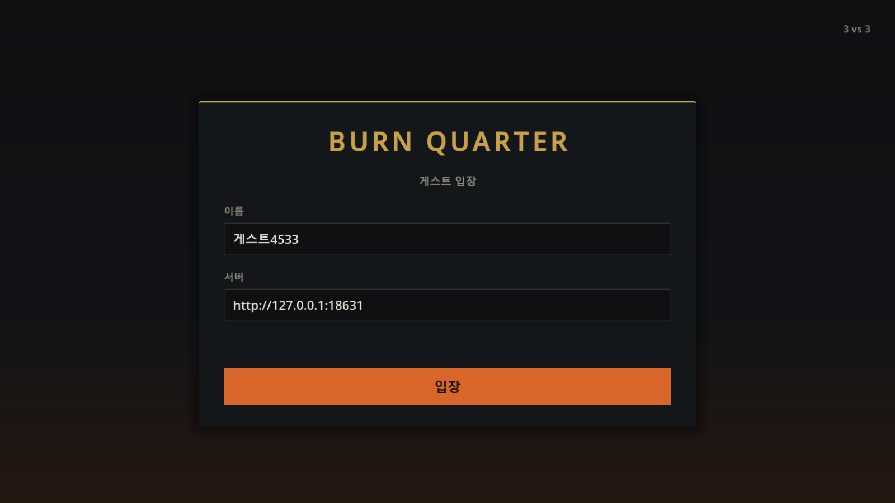
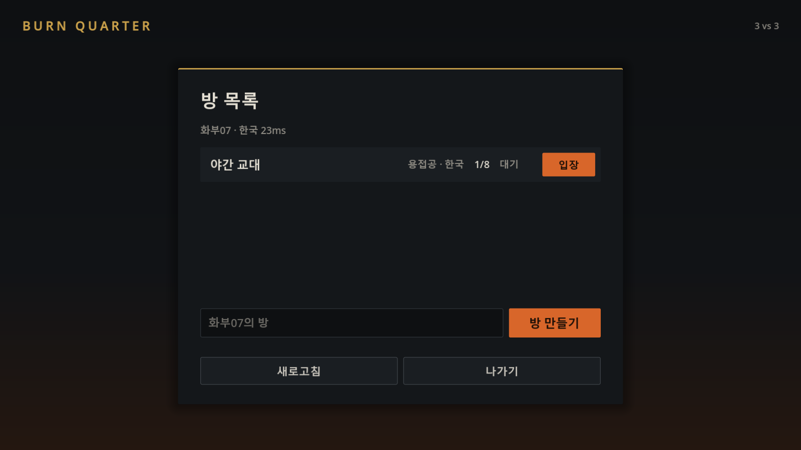
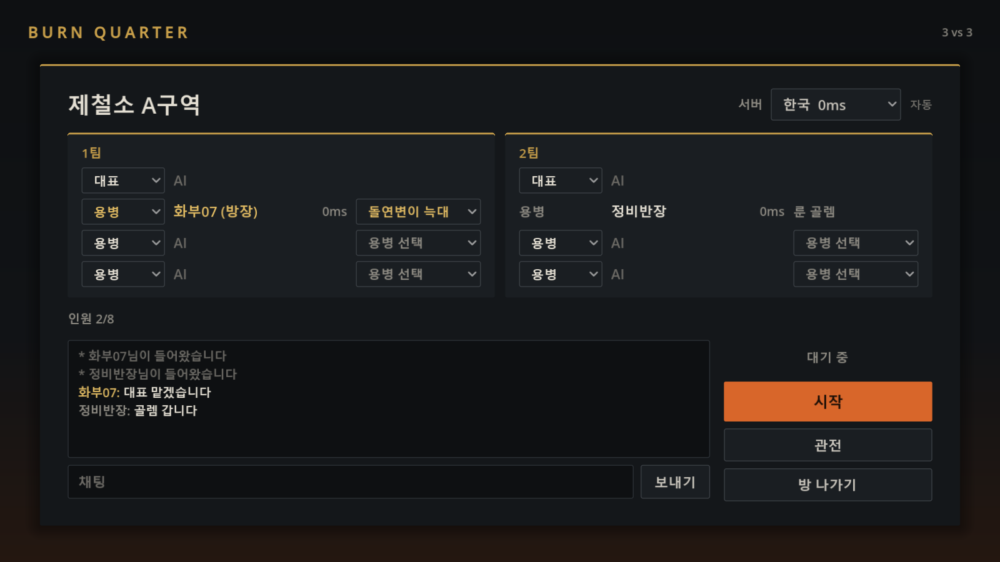

# 지인 테스트: 로비와 방에서 전장까지

## 게스트 입장과 방

로그인은 없습니다. 첫 화면에서 이름과 로비 주소를 정하고 **입장**합니다. 이름·주소와 로비 세션은 `user://network.cfg`에 저장되어, 게임을 다시 켜도 같은 로비면 들어가 있던 방과 진행 중인 경기로 돌아올 수 있습니다.

입장·방 목록·방·로딩 화면은 그을린 철 바탕에 황동 제목·테두리, 용광로 주황의 주요 버튼(입장·방 만들기·시작) 세 가지 색만 씁니다([아트 디렉션](art-direction.md#효과와-ui)). 긴 설명 대신 짧은 라벨을 두고, 자리 선택 안내와 서버 선택 규칙은 칸에 마우스를 올리면 나옵니다.





- **로비**: 방 목록(방 이름·방장·인원·서버·대기/진행 중)과 **방 만들기**, **새로고침**이 있습니다. 목록은 새로고침을 누를 때만 다시 받습니다. 꽉 찼거나 게임 중인 방에는 들어갈 수 없습니다.
- **방**: 1팀·2팀이 각각 대표(지휘관) 1칸과 용병(영웅) 3칸입니다. 비어 있거나 내가 앉은 줄의 왼쪽 칸에서 **대표**나 **용병**을 고르고, 용병 줄 오른쪽 칸에서 늑대·골렘·사령관 중 하나를 고릅니다. 대표는 팀에 한 명이고, 같은 팀에서 이미 누가 고른 용병은 고를 수 없습니다. 다른 팀은 같은 용병을 고를 수 있습니다. 내 줄 왼쪽 칸의 **비우기**로 자리를 비우고, 아래 **관전**으로 관전합니다(다시 누르면 관전 취소). 아무도 앉지 않은 칸은 **AI**로 보입니다.
- **채팅**: 방 안에서만 쓰는 간단한 채팅입니다(200자). 입장·퇴장·방장 변경·서버 변경·시작은 회색 안내 줄로 보입니다. 인게임 채팅과 핑(신호) 기능은 아직 없습니다.
- **서버**: 방장이 고릅니다. 기본은 방장의 핑이 낮은 쪽이고, 방장이 직접 고르면 그대로 둡니다. 이름 옆 숫자는 각자 선택된 서버까지의 핑입니다.
- **시작**: 방장이 **시작**을 누르면 5초 카운트다운 뒤 모두 로딩 화면으로 넘어갑니다. 카운트다운 중에는 자리를 바꿀 수 없고 방장이 **시작 취소**를 누를 수 있습니다. 아직 고르지 않은 사람은 남은 칸에 앉고, 빈칸은 AI가 맡습니다. 혼자 방을 만들어 시작하면 혼자 연습, 관전을 고르고 시작하면 AI끼리 경기 관전입니다.
- 방장이 나가면 먼저 들어온 사람이 방장이 됩니다. 경기가 끝나면 같은 방, 같은 자리로 돌아옵니다.
- 참가자 전원의 맵 해시 확인·초기 상태 수신이 끝나야 게임 틱과 조작을 시작합니다. 로딩 중에 누가 **방으로 돌아가기**를 누르면 그 자리는 AI가 맡고 나머지는 그대로 시작합니다. 90초 안에 준비하지 못한 사람의 자리도 AI가 맡습니다.
- 시작 후 연결이 끊기면 그 자리는 사라지지 않고 AI가 대신 조종합니다. 게임 화면은 "다시 연결하는 중" 안내를 띄우고 같은 입장권으로 2초마다 다시 접속합니다. 서버 메시지가 5초 넘게 오지 않아도 끊긴 것으로 보고 다시 접속합니다. 다시 붙으면 지금 전장을 새로 받아 하던 자리를 이어서 조종합니다. 2분 안에 붙지 못하면 방으로 돌아갑니다.
- 상단의 **방으로 나가기**를 누르면 서버에 `LEAVE`를 보내고 나갑니다. 자리는 AI가 이어받고 남은 사람은 계속 플레이합니다. 경기가 아직 진행 중이면 방에 **경기로 돌아가기**가 나타납니다.
- 같은 팀원이 끊겨 AI가 조종하는 동안에는 화면 위쪽 가운데에 "연결 끊김 · AI가 대신 조종 중"과 그 자리 이름이 보이고, 영웅의 팀원 창에는 `AI 대행`이 붙습니다.
- 적 본진 HQ를 파괴하면 승리하며 같은 틱의 양쪽 본진 파괴는 무승부입니다. 결과 확정 후 조작과 시뮬레이션을 멈춥니다. 결과 화면에서 방으로 돌아갑니다.
- 여러 방이 동시에 경기할 수 있습니다(로비 `-game-ports`, 기본 8판). 사람이 모두 **방으로 나가기**로 나가면 게임을 바로 정리하고, 모두 연결이 끊긴 경우에는 경기를 멈추고 서버 `matchRejoinGrace`(2분) 동안 돌아오기를 기다린 뒤 정리합니다. 승패 또는 최대 2시간 제한에 따른 무승부가 확정되면 결과 전송 후 10초 뒤 서버를 정리합니다. 결과 화면은 연결 종료 뒤에도 유지됩니다. 이전 판의 상태는 다음 판에 남지 않습니다.

## 서버 구성

```text
Godot 클라이언트 ── HTTP :8080 ── 로비 서버 (계속 실행)
       │  └──── TCP :7700 (지역 핑)    │ 방장이 시작하면 실행 / 종료 감시
       └──────── TCP :7777~ ── 게임 서버 (판마다 별도 프로세스, 포트 하나씩)
```

로비 실행 파일은 `project-w-server/cmd/lobby`, 게임 실행 파일은 기존 Go 모듈 루트입니다. 둘 다 같은 라즈베리파이에서 실행합니다. 게임 서버를 미리 따로 켜지 마세요. 로비가 `-game-port`부터 `-game-ports`개의 포트에 경기마다 게임 서버를 띄웁니다. 별도 DB나 Redis는 필요 없습니다. 로비를 재시작하면 방과 세션이 초기화되지만 진행 중인 경기는 끝까지 진행합니다.

로비는 경기마다 사람별로 임의의 128비트 입장권을 새로 만듭니다. 팀·역할·입장권 목록은 자식 게임 프로세스의 표준 입력으로 전달하며, 각 클라이언트는 자기 입장권만 받습니다. 게임 서버는 맵 해시와 입장권을 확인하고 한 번만 입장시킵니다. 클라이언트가 초기 상태를 적용한 뒤 `LOADED`로 확인하면 전원 준비 후 `MATCH_START`를 보냅니다. 기존 `MAP_READY ... COMMANDER/HERO` 방식으로 매칭 서버에 직접 입장할 수 없습니다.

로비 HTTP API는 서버 문서 `project-w-server/docs/match-and-bots.md`의 "로비와 방"에 있습니다. 클라이언트는 방에 있는 동안 0.5초 간격으로 방 상태를 확인하며, 방에서 15초 동안 소식이 없는 사람은 내보냅니다. 방 밖에서는 10초마다 살아 있음을 알립니다. 이것은 계정·로그인·TLS가 없는 지인 테스트용 서버입니다. 같은 LAN이나 공유 VPN으로 먼저 테스트할 수 있습니다.

## Windows에서 로컬 실행

서버 폴더에서:

```powershell
go build -o project-w-game.exe .
go build -o project-w-lobby.exe ./cmd/lobby
./project-w-lobby.exe -game-bin ./project-w-game.exe -game-host 127.0.0.1
```

Godot .NET으로 클라이언트 `project.godot`를 열고 리소스를 가져온 뒤 C#을 빌드합니다. F5로 로비를 열고 주소에 `http://127.0.0.1:8080`을 입력해 게스트로 입장합니다. 창 하나에서는 방을 만들어 바로 시작하면 혼자 연습이고, 창을 여러 개 띄우면 한 창에서 만든 방에 다른 창이 목록에서 들어갑니다. 로비 주소는 `user://network.cfg`에 저장됩니다. 이 파일이 없으면 게임 이름을 바꾸기 전 사용자 폴더(`app_userdata/Project W`)에 저장한 주소를 읽습니다.

시작 카운트다운은 `-countdown 5s`, 동시 경기 수는 `-game-ports 8`로 바꿉니다. 서버 포트를 바꾸려면 로비의 `-listen :8080`, `-game-port 7777`, `-ping-port 7700`을 사용합니다. `-regions kr:한국,us:미국`처럼 지역을 여러 개 주면 방에서 서버를 고를 수 있습니다. 지금은 모든 지역의 경기를 로비 컴퓨터에서 엽니다.

기존 개발용 F6 직접 실행도 유지합니다. 이때만 게임 서버를 `go run .`으로 별도로 실행하고 Main/AOS 씬에서 `127.0.0.1:7777`로 접속합니다. 로비 운영과 동시에 사용하면 포트가 겹칩니다.

## 라즈베리파이 5 배포 (64비트 Linux)

Windows의 서버 폴더에서:

```powershell
./deploy/build-pi.ps1
```

`dist/pi/`에 게임 서버, 로비 서버, 맵, 서비스 예시가 생성됩니다. 이 폴더 전체를 Pi의 `/opt/project-w`로 복사합니다. ARM64 빌드이므로 64비트 OS가 필요합니다. Pi에서 직접 빌드하려면 `go build -o project-w-server .`와 `go build -o project-w-lobby ./cmd/lobby`를 사용할 수도 있습니다.

Pi에서 수동 실행:

```sh
cd /opt/project-w
chmod +x project-w-server project-w-lobby
./project-w-lobby -game-bin ./project-w-server -game-host 친구가_접속할_IP
```

`-game-host`에는 **친구 PC에서 접근할 Pi의 IP/DNS**를 입력합니다. 같은 집에서는 LAN IP, 공유 VPN에서는 VPN IP, 포트포워딩을 사용하면 공인 IP/DNS입니다. `127.0.0.1`을 넣으면 친구 PC 자신의 주소로 연결하므로 외부 테스트에 사용할 수 없습니다. 외부 직접 접속 시 로비 **TCP 8080**, 지역 핑 **TCP 7700**, 게임 **TCP 7777부터 동시 경기 수만큼**(기본 7777~7784)이 Pi로 연결되어야 합니다. 친구에게는 `http://접속주소:8080`을 전달합니다.

자동 시작이 필요하면 서버의 `deploy/project-w-lobby.service`와 `deploy/project-w.env.example`을 사용합니다. 서비스 계정 `projectw`를 만들고 `/etc/project-w.env`에 `GAME_HOST`를 설정한 뒤 서비스 파일을 `/etc/systemd/system/`에 설치합니다. 서비스는 `/opt/project-w`에서 실행하며, 종료 시 자식 게임 프로세스도 함께 정리합니다.

```sh
sudo useradd --system --no-create-home projectw
sudo cp /opt/project-w/project-w.env.example /etc/project-w.env
sudo nano /etc/project-w.env
sudo cp /opt/project-w/project-w-lobby.service /etc/systemd/system/
sudo systemctl daemon-reload
sudo systemctl enable --now project-w-lobby
journalctl -u project-w-lobby -f
```

Pi의 실제 수용 성능은 플레이 인원보다 유닛 수·경로 탐색·시야 계산에 영향을 받습니다. 로그의 `[tick]`이 **30 tps**를 유지하는지, 최대 계산 시간이 **약 33.3ms**를 자주 넘는지 보세요. PC에서의 기능 검증은 Pi 성능 측정을 대신하지 않습니다.

## 클라이언트 배포 빌드

Windows에서는 클라이언트 프로젝트 폴더에서 다음 명령으로 내보냅니다. Godot 에디터에서 한 번 연 프로젝트는 설치 경로를 자동으로 읽으며, 필요하면 `-GodotPath 'C:\tools\Godot\Godot.exe'`로 .NET 에디터 경로를 지정합니다.

```powershell
./tools/export-windows.ps1
```

스크립트는 C# Debug 어셈블리를 먼저 빌드하고, `.godot/exported`의 변환 장면 캐시를 `.godot/export-backups`로 보관한 뒤 새 에디터 프로세스로 Release를 내보냅니다. C#의 `[Export]` 필드를 추가했을 때 오래된 장면 캐시에 노드 연결이 누락되는 문제를 방지합니다. 결과는 프로젝트 옆 `build/` 폴더이며, 로그는 `.godot/check-logs/export-windows/`에서 확인합니다. ZIP 파일은 자동 갱신되지 않으므로 배포할 때 새 `build/` 폴더를 압축하세요.

Godot 4.7.2 **.NET** 에디터와 같은 버전의 내보내기 템플릿을 사용합니다. Export에 Windows Desktop 프리셋을 만들고 x86_64로 내보냅니다. 비리소스 포함 필터에 **`*.json`**을 추가해 `maps/test.json`과 건설 미리보기 목록을 포함합니다. 로비와 로딩은 기본 메인 씬에서 참조되며 실제 Main 씬도 내보내기에 포함해야 하므로 모든 리소스 내보내기를 사용합니다.

실행 파일만 보내지 말고 내보내기 폴더 전체를 압축해서 전달하세요. 클라이언트와 서버의 `maps/test.json`은 바이트 단위로 같아야 합니다. 빌드 파일에서 두 PC로 같은 팀 협동을 확인한 뒤 6인 대전을 확인합니다.

## 검증

서버의 `go test ./...`는 기존 게임 검사와 함께 게스트 세션·방 목록·자리 중복·카운트다운·시작 취소·AI 채우기·채팅·만료·지역 선택·입장권·로딩 장벽을 확인합니다.

클라이언트의 기본 검증은 계속 서버 없이 실행합니다. 실제 연결 검증은 별도 명령입니다:

```powershell
./tests/run.ps1 -Check MapSyncChecks -GodotPath 'C:\tools\Godot\Godot_console.exe'
./tests/run-match.ps1 -Players 2 -SkipBuild -GodotPath 'C:\tools\Godot\Godot_console.exe'
./tests/run-match.ps1 -Players 1 -SkipBuild -GodotPath 'C:\tools\Godot\Godot_console.exe'
./tests/run-match.ps1 -Players 6 -SkipBuild -GodotPath 'C:\tools\Godot\Godot_console.exe'
```

`run-match.ps1`은 사용하지 않는 로컬 포트에 실제 로비·게임 서버와 Godot 클라이언트를 띄웁니다. 1번 클라이언트가 방을 만들고 나머지는 목록에서 들어가 자리를 고른 뒤, 방장이 시작해 로딩·역할 확정·전장 진입·방 복귀·같은 방에서 새 경기를 확인합니다. 2인 검사에서는 시작 뒤 카운트다운 취소도 확인합니다. 서버가 다른 폴더(작업 트리)에 있으면 `-ServerRoot`로 지정합니다. 프로세스는 검사 후 정리되며 로그는 `.godot/check-logs/match-2` 또는 `match-6`에 저장됩니다. 서버 빌드를 위해 Go가 필요합니다. 리소스 가져오기와 C# 빌드를 끝냈다면 `-SkipBuild`로 중복 빌드를 피합니다.

## 변경 경계

로비·방·로딩 화면과 세션(`network/MatchSession.cs`)이 방 상태, 배정, 장면 전환, 결과 화면과 복귀를 관리합니다. 서버의 봇 판단 계층은 기존 이동·채집·건설·생산·스킬 명령을 사용하며 동일한 비용·사거리·시야·쿨다운 검사를 받습니다. 본진 승패 판정은 틱 종료 시 한 번 확정합니다. 중도 퇴장하거나 연결이 끊긴 사람의 자리는 서버의 규칙 봇이 인계하며, 규칙은 서버 `docs/match-and-bots.md`의 끊김과 재접속을 따릅니다.
