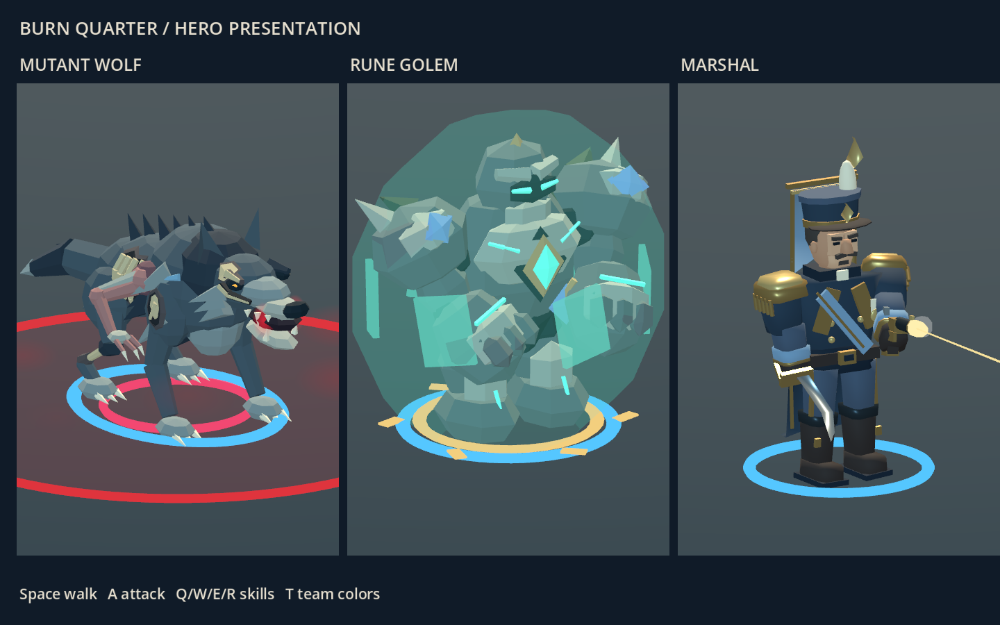

# 영웅 화면과 조작

> 게임 규칙과 수치의 기준은 서버 저장소 `project-w-server/docs/`입니다. 이 문서는 클라이언트 화면과 조작을 설명합니다.

## 공통

`WELCOME id 편 COMMANDER`는 RTS 정보창, `WELCOME id 편 HERO 영웅종류`는 가운데 하단의 AOS 스킬 패널을 표시합니다. 늑대는 Q키나 Q 버튼을 누른 뒤 적 유닛을 클릭하면 물어뜯기를 사용합니다. 대상 지정 중에는 늑대 주변에 사거리 원을 표시합니다. Esc·우클릭으로 대상 지정을 취소하며, 스킬마다 서버 기준 남은 재사용 시간을 표시합니다. 패시브는 항상 적용되고, W는 다음 일반 공격 또는 Q 명중 시 흡혈, E는 주변 지속 피해, R은 아군 미니언·용병을 먹는 포식입니다. 맵·미니맵은 공유하고, AOS의 오른쪽 명령창은 208×160 간단 정보 패널로 바뀝니다. 기본은 내 영웅이며 다른 유닛을 클릭하면 그 유닛의 체력과 능력치를 표시합니다. 내 영웅의 레벨·경험치바는 서버의 EXP 수신값으로 갱신합니다.

AOS에서는 내 영웅이 생성되면 자동으로 조종 대상으로 고정됩니다. 별도 선택 없이 우클릭·미니맵 우클릭으로 이동하고 적 우클릭으로 공격합니다. A/S/D도 같은 영웅을 조종하며 빈 곳·다른 유닛·건물 클릭이나 드래그로 해제되지 않습니다. 다른 유닛을 좌클릭하면 오른쪽에 초상화·이름·체력·행동·공격력·사거리만 표시하며 명령 대상은 바뀌지 않습니다. 조회 대상이 죽거나 시야에서 사라지면 정보를 비웁니다. 내 영웅의 사망·시야 이탈·소유권 상실 시 명령을 멈추고, 다시 생성되면 자동으로 연결합니다. RTS는 기존 수동 선택과 명령창을 유지합니다.

경기 시작 시 내 영웅 또는 본진을 가까이 보여주며, 상단에는 진영·역할·경과 시간을 한 줄로 표시합니다. 공물 상태는 바로 아래 작은 한 줄로 표시하고 상시 조작 안내와 승리 목표 설명은 생략합니다. 영웅 모드에서는 지휘관 전용 자원·인구 UI와 수신하지 않은 마나를 숨깁니다. 미니맵의 내 영웅은 밝은 큰 표식으로 구분합니다. 다친 유닛은 선택하지 않아도 체력바를 표시하지만, 안개로 숨겨진 유닛의 정보는 표시하지 않습니다.

사망 시 `RESPAWN 부활틱`과 서버 `TICK`으로 남은 초를 표시합니다. 부활 예정 시간이 지나도 새 영웅이 생성되지 않았다면 부활 위치 확보 중으로 안내하며, 실제 UNIT 수신 후 정상 상태로 돌아갑니다. 스킬 대상 지정·기절·침묵·체력 위험도 영웅 패널에 안내합니다.

## 늑대 (200)

첫 영웅(200)은 사족보행하는 돌연변이 늑대입니다. 오른쪽 옆구리의 작은 팔 하나, 긴 주둥이·송곳니·날카로운 갈기와 군데군데 드러난 뼈로 구분하며 별도의 모델·초상화·보행·물기 연출을 사용합니다. 서버의 UNIT/POS/STATE/HP/STATS와 기존 타입 번호는 그대로 사용합니다. AOS 체력바는 내 영웅의 HP를, 그 아래 마나바는 서버 `MANA`를 표시합니다.

외형은 `previews/MutantWolf.tscn`을 F6으로 열어 세 시점에서 확인합니다. Space는 걷기, A는 물기, Q는 돌진 자세, R은 회전, T는 진영색 전환입니다. [영웅 미리보기](images/mutant-wolf.png).

물기에는 준비·반동 동작을, W에는 송곳니 발광을, E에는 안개·파문을, R에는 몸으로 모이는 입자를 표시합니다. 서버가 승인한 스킬과 효과 상태로만 연출하며 유닛 위치나 피해를 예측하지 않습니다.

늑대 **W · 피의 송곳니**는 다음 일반 공격 또는 Q 명중으로 실제 깎은 체력의 일부를 회복합니다. 명중으로 W를 소모하면 재사용 시간이 시작됩니다. Q가 빗나가거나 중단되면 W는 유지되며, E는 W를 소모하지 않습니다. 보호막 피해·초과 피해는 회복에 포함하지 않고 최대 체력을 넘지 않습니다. **E · 피의 안개**는 늑대를 따라다니는 영역에서 주기적으로 피해를 줍니다. 흡혈량·타격 횟수·재사용 시간은 서버 `hero_wolf.go`의 정의와 스킬 강화 상태를 따릅니다. W/E 모두 키나 버튼을 누르면 바로 발동합니다. 분홍 고리는 W 대기, 붉은 영역은 E 활성 상태이며 하단에도 남은 효과를 표시합니다. W/E 상태는 서버 `WOLF` 메시지로 동기화되어 안개 재등장 시 복원되고 사망·부활 시 초기화됩니다. 늑대 W도 카메라 이동과 겹치지 않습니다.

## 룬 골렘 (201)

두 번째 영웅(201)은 **룬 골렘**입니다. 로비의 영웅 선택에서 고르면 영웅 역할로 배정될 때 적용됩니다. 돌주먹·청록색 룬 심장·진영색 어깨판, 관절 보행과 주먹 공격, 보호막·충격파 효과를 사용합니다. 패시브 돌가죽은 받는 피해를 줄이며 패시브 강화에 따라 효과가 달라집니다.

좌우 주먹 타격, 내려찍기 준비·반동, 돌 파편·먼지, 떠 있는 보호막 조각과 회전하는 룬 문양으로 스킬을 구분합니다. 파편은 짧게 사라지는 시각 효과이며 지형·충돌에는 영향을 주지 않습니다.

| 키 | 기술 | 효과 |
| --- | --- | --- |
| Q | 내려찍기 | 주변 적에게 피해와 둔화. **R 강화:** 범위와 피해가 커지며 기본 둔화는 적용하지 않음 |
| W | 돌갑옷 | 최대 체력에 비례한 보호막. **R 강화:** 보호막량 증가 |
| E | 바위 돌진 | 적 클릭 후 돌진하여 피해와 기절. 장애물에 막힘. **R 강화:** 기절 시간 증가 |
| R | 룬 각성 | 다음에 성공적으로 사용하는 Q/W/E를 룬 강화. 사용하거나 사망할 때까지 유지되며 중첩되지 않음. 궁극기 강화로 적용 횟수가 늘어남 |

Q의 기절은 스킬 포인트로 Q를 4차 강화했을 때 일반·룬 강화 시전에 추가됩니다. R만으로는 Q에 기절이 생기지 않습니다. 피해·범위·지속 시간·재사용 시간은 서버 `hero_golem.go`, 스킬 강화는 `hero_progression.go`, 패시브 강화는 `hero_passive.go`의 정의를 따릅니다.

Q/W/R은 누르면 바로 사용합니다. R→Q는 넓은 범위의 피해, R→W는 생존, R→E는 단일 대상 기절에 투자하는 선택입니다. R 자체는 공격하지 않습니다. 금색 룬 고리와 하단 상태·툴팁이 강화 대기를 표시하며, 일반 공격·대상 선택 취소·시전 거절·E 접근 이동으로는 소모되지 않습니다. 준비 상태는 `GOLEM id 강화대기(0|1)`, 강화 시전은 `SKILL 시전자 슬롯 [대상ID] EMPOWERED`로 동기화합니다. 골렘의 Q/W는 스킬에 사용하며 카메라는 화면 가장자리·가운데 버튼 드래그·미니맵으로 움직입니다. `previews/RuneGolem.tscn`을 F6으로 실행하면 서버 없이 모델과 스킬 연출을 볼 수 있습니다(Space 걷기, A 주먹, Q/W/E 기술, R 다음 기술 강화, Y 회전, T 진영색). [룬 골렘 미리보기](images/rune-golem.png). 서버와 클라이언트를 함께 갱신해야 선택과 스킬이 적용됩니다.

## 사령관 (202)

사령관(202)은 이전 클라이언트의 장교 모델을 복원했습니다. 군복·견장·훈장·장교모자, 곡도·권총과 양면 문양 깃발로 구분하며, 이동할 때 옷자락과 깃발이 움직입니다. 일반 공격은 곡도 타격, Q는 조준·총구 섬광·연기·탄도, W는 보호막, E는 전진 화살표, R은 지휘 링으로 표현합니다. Q의 조준은 승인된 `SKILL` 메시지의 현재 보이는 대상만 사용하며, 숨겨지거나 제거된 대상을 계속 추적하지 않습니다. E/R은 `MARSHAL`의 종료 틱과 `TICK`으로 만료됩니다.

I로 상점을 열고 B로 귀환합니다. 필드에서 구매한 아이템은 상자로 배달되며 내 영웅으로 상자를 우클릭해 줍거나, 지휘관이 자신의 일꾼을 선택한 뒤 상자를 우클릭해 배달시킬 수 있습니다. 가격·업그레이드 조건·실제 장착과 효과는 서버가 결정합니다.

## 디자인 미리보기

`previews/HeroVisuals.tscn`을 F6으로 실행하면 세 영웅의 모델·스킬 효과를 함께 확인할 수 있습니다. Space 걷기, A 일반 공격, Q/W/E/R 스킬, T 진영색 전환을 지원합니다. 이 장면의 체력·보호막·효과 시간은 연출을 보기 위한 모의 값입니다.

렌더 모드에서 `-- --capture`를 넘기면 아래 이미지를 저장합니다. 이번 복원은 `units.zip`에 포함된 모델·애니메이션만 대상으로 했으며 스킬 아이콘과 기타 UI는 기존 리소스를 유지합니다.

