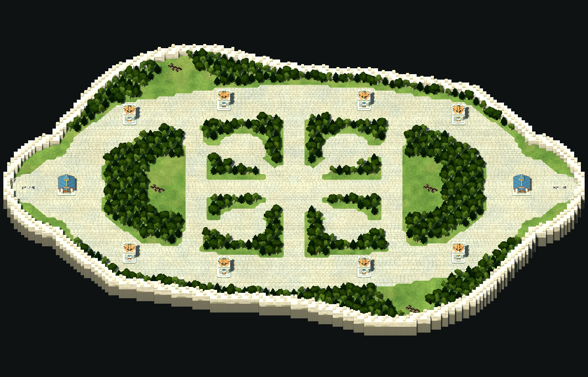
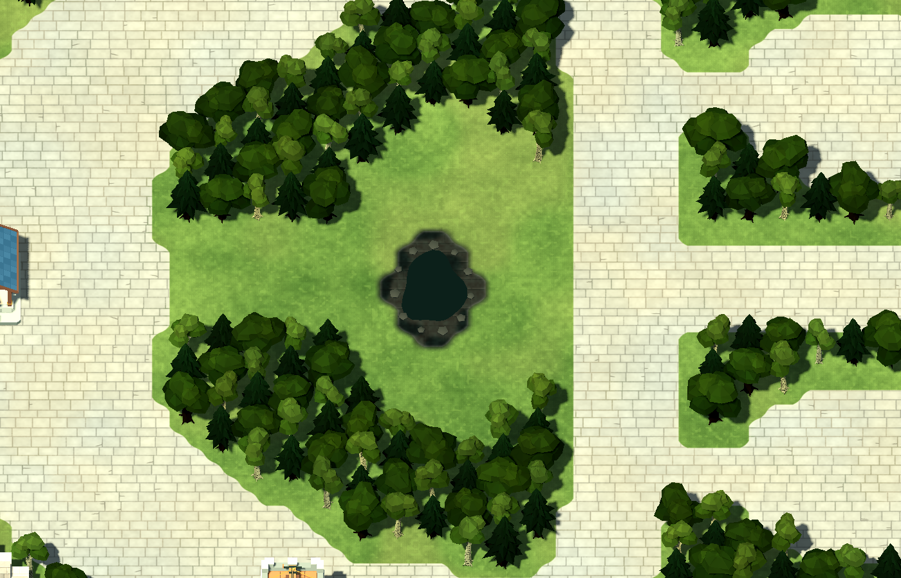
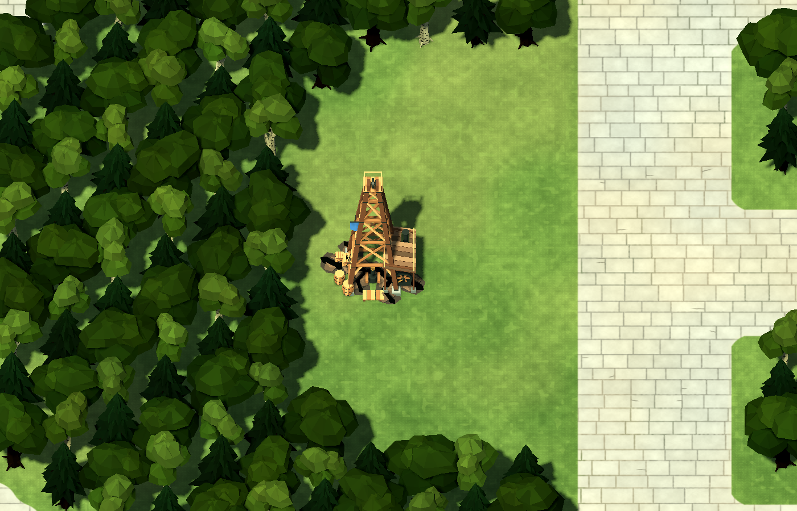
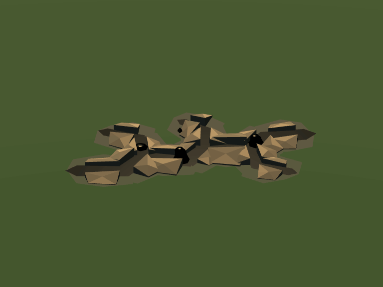

# 중앙·정글과 유전 공터

지도는 원점 기준 180도 회전 대칭입니다. 중앙 공물 광장과 네 곳의 정글 공터, 상·하단 공격로, 각 본진과 요새, 성곽 확장 부지를 유지합니다. 유전은 중앙 양옆과 상단·하단 멀티에 하나씩, 총 네 곳에 있습니다. 중앙 유전의 본진 쪽은 숲으로 막혀 있어 시작부터 회관에서 직진할 수 없고, 기존 공격로와 중앙 도로를 따라 돌아 들어가야 합니다. 유전마다 시추탑 한 채를 건설할 수 있습니다. 기름 채집·저장·소비 기능이나 AI의 시추탑 건설 행동은 아직 없습니다.



이 이미지는 실제 `maps/test.json`의 지형·초기 나무·시작 건물을 서버 없이 렌더링한 미리보기입니다. 실제 경기나 AI 평가 화면은 아닙니다.

## 중앙과 정글

| 구역 | 중심 (X, Z) | 크기 | 지면 |
| --- | --- | --- | --- |
| 이벤트 광장 | (0, 0) | 반경 9 | 회색 석재 도로 |
| 정글 공터 네 곳 | (±15, ±13) | X 반경 7, Z 반경 6 | 회색 석재 도로 |
| 정글 진입로 | 공터 중심에서 (±6, ±5), (±28, ±13)까지 | 폭 4 | 회색 석재 도로 |

각 정글 공터는 중앙 광장 쪽과 바깥 연결로 쪽에 입구를 둡니다. 좌표의 부호는 해당 공터의 사분면을 따르며, 공터 사이와 라인 가장자리에는 숲을 남깁니다. 공물의 진행·수집·보상은 서버가 판정합니다. 지형 메타데이터가 이벤트 진행을 대신하지 않으며, 현재 조작은 [게임 모드와 화면](game-modes.md#중앙-공물과-공성추)을 참고하세요.

## 중앙 양옆의 유전 공터

| 구역 | 서쪽 | 동쪽 | 크기·역할 |
| --- | --- | --- | --- |
| 잔디 공터 중심 | (-36, 0) | (36, 0) | 반지름 (6, 10), 가로 12·세로 20 |
| 중앙 쪽 입구 | 공터 중심부터 (-28, ±8)까지 | 공터 중심부터 (28, ±8)까지 | 폭 5, 기존 중앙 도로와 연결 |
| 유전 중심 | (-39, 0) | (39, 0) | 반지름 (2.6, 3.6) |
| 보급기지 배치 예시 중심 | (-34, 5) | (34, -5) | 4×4 건물 면적이 잔디 안에 놓이는 위치 |

중앙 유전 공터는 중앙 도로를 향해 열려 있습니다. 본진 방향의 직선 연결로는 제거하고 나무를 복원했습니다. 일꾼은 기존 상·하단 공격로를 따라 중앙 도로 쪽으로 돌아와야 하며, 숲을 벌목한 뒤에야 더 짧은 길을 만들 수 있습니다. 지도 전체의 기존 공격로·벽은 유지하며 유전 공터와 입구만 비웁니다. 나무 배치와 맵 해시가 바뀌므로 이전 경기의 상태는 재사용하지 않습니다.

유전의 건설 제한 영역은 기존 `R` 타일입니다. **빈 유전은 통행할 수 있고, 건물은 시추탑만 중심에 한 채 지을 수 있습니다.** 일반 건물은 기존처럼 이 영역에 지을 수 없으며, 주변 `.` 잔디에는 장애물이 없으면 건설할 수 있습니다. `oilFields` 메타데이터는 유전의 위치와 전용 건설 위치를 지정합니다. 네 곳 모두 같은 `maps/Oilfield.tscn` 모델을 같은 크기와 방향으로 배치합니다. 지도 규칙을 위한 새 타일은 추가하지 않았습니다. 기름 잔량, 채집 명령, 자원 ID는 아직 없습니다. 유전 연출 자체에는 충돌체가 없지만 시추탑 공사 부지가 생성되면 일반 건물처럼 점유 영역을 차단합니다.



보급기지(건물 종류 2, 기존 저장소)는 4×4입니다. 위 배치 예시는 유전의 건설 제한 영역을 피한 위치이며 건설은 항상 서버가 현재 지도와 다른 건물의 점유를 확인합니다. 보급기지가 기름을 채집하거나 보관한다는 뜻은 아닙니다.

시추탑(건물 종류 7)은 유전 중심의 4×4 공간을 점유합니다. 일꾼의 1티어 메뉴에서 D로 선택합니다. 유전 영역이 겹치는 지도에서는 클릭한 지점과 가장 가까운 중심을 사용합니다. 건설·취소·재건설 규칙은 [시추탑](../buildings/README.md#유전-전용-시추탑)을 참고하세요.



## 성곽 확장 부지

1팀 확장 부지는 상단 요새 사이의 바깥쪽, 2팀 확장 부지는 이를 180도 회전한 하단 위치입니다. `EXPANSION_SWELL_*`은 라인 바깥의 외곽 띠를 완만하게 넓혀 기존 석벽과 이어 줍니다. `EXPANSION_BAY_*`은 도로 가장자리에 바닥을 붙인 돔 모양 잔디밭을 만듭니다. 입구 전체가 라인과 연결되고 양옆과 뒤는 숲입니다.

사이트 표시 위치는 (-34, -37), (34, 37)입니다. `expansionSites.buildSize=[4,4]`는 각 중심에서 보장하는 빈 건설 면적이며 보급기지를 놓을 수 있습니다. 실제 건물 크기는 서버 정의를, 건설 가능 여부는 `rows`·나무·건물 점유를 따릅니다.

멀티 유전은 공터 뒤쪽의 (-34, -42), (34, 42)에 있으며 반지름은 (3.6, 2.2)입니다. 외곽 벽을 침범하지 않고, 도로에서 공터를 통해 접근할 수 있습니다. 앞쪽의 기존 4×4 보급기지 자리는 유전과 겹치지 않습니다. 중앙 유전과 마찬가지로 유전 중심은 통행 가능·건설 불가 지형입니다.

## 라인 바깥 숲과 본진 잔디

라인 바깥쪽은 벽까지 숲으로 채우되 각 회관 주위의 잔디(`BASE_MEADOW_RADIUS`)와 성곽 확장 부지를 남깁니다. 바깥 숲은 벽에 가까운 자리부터 완전한 2×2 나무를 심고, 180도 회전 위치에 짝으로 배치합니다. 나무가 온전히 들어가지 않는 자투리 칸은 잔디로 남습니다. 자투리 칸이 있다는 것만으로 건설 가능한 공간이라고 판단하지 않습니다.

안쪽 숲도 격자에 맞춰 심지만 유전 공터·연결로와 기존 도로·활동 구역을 침범하지 않습니다. 벌목하면 나무가 차지하던 땅을 기존 규칙대로 사용할 수 있습니다. 새 회관 건설 기능은 추가하지 않습니다.

## 구역 규칙

| 맵 데이터 | 표시 | 이동 및 건설 |
| --- | --- | --- |
| `R` | 석재 도로·광장·진입로, 유전 구역에서는 균열 지형 | 이동 가능, 일반 건물 건설 불가. 등록된 유전 중심의 시추탑만 예외 |
| `.` | 풀밭 | 장애물이 없으면 이동·건설 가능 |
| `T` | 초기 나무의 시작 칸 | 나무의 2×2 영역을 차단하며 벌목 후 풀밭으로 사용 |
| `W` | 외곽 석벽 | 이동·시야·건설 차단, 채집 불가 |
| `#` | 맵 바깥 | 이동·건설 불가 |

나무 한 그루는 시작 칸에서 +X/+Z 방향으로 2×2칸을 차지합니다. 나무 점유 영역이 도로나 벽과 겹치는 지도는 클라이언트와 서버가 거부합니다. 건물은 전체 면적이 건설 가능한 칸에 들어가야 하며, 시작 건물과 다른 건물의 점유도 피해야 합니다. 클라이언트는 미리보기에서 배치 제한을 표시하고 서버는 BUILD 요청과 현장 도착 시 다시 검사합니다.

`R`은 이동·시야를 막지 않으며 벌목이나 건물 파괴로 건설 금지가 해제되지 않습니다. 미니맵은 일반 도로를 회색, 유전 지면을 어두운 청록색, 빈 풀밭을 초록색, 나무를 진한 초록색으로 표시합니다. 벌목 후에는 나무 영역의 미니맵 표시와 건설 가능 여부가 함께 바뀝니다.

## 열기

- `game/Main.tscn`: JSON에서 지형·나무를 생성하고 서버와 동기화하는 실제 게임입니다.
- `previews/Forest.tscn`: 서버 없이 지형·초기 나무·시작 건물을 확인합니다. 편집기에서 열고 F6으로 실행합니다.
- `previews/Arena.tscn`: 나무가 없는 지형 미리보기입니다.
- `previews/Oilfield.tscn`: 공통 유전 모델과 기름 애니메이션을 확인합니다. 드래그로 회전하고 휠로 확대·축소합니다.
- `maps/SymmetricArena.tscn`: 편집용으로 생성한 지형 캐시입니다. 실제 게임은 이 캐시 대신 JSON을 읽습니다.

미리보기에서는 휠로 확대·축소하고 가운데 버튼 드래그나 화면 가장자리로 이동합니다. Home은 전체 보기로 돌아갑니다. 카메라의 전체 보기 배율과 이동 범위는 생성 지형의 원점·크기를 사용합니다.

## 좌표와 데이터

좌우는 X, 위아래는 Z, 높이는 Y입니다. 본진 중심은 (-65, 0), (65, 0)입니다. 지도 원점은 (-84, -64), 한 칸은 1×1, 전체 배열은 168×128입니다. 상·하단 공격로와 기존 포탑·본진 좌표는 이번 유전 추가에서 유지합니다.

`rows`가 이동·건설·나무 배치 판정의 기준입니다. `activityAreas`는 이벤트·정글·본진 보급 구역을 설명합니다.

| 필드 | 의미 |
| --- | --- |
| `id` | `center_event`, `jungle_nw`, `team1_spawn` 등 구역 식별자 |
| `kind` | `event`, `jungle`, `spawn` |
| `center` | 월드 좌표 `[X, Z]` |
| `radii` | 타원의 X·Z 반경 |
| `entrances` | 중심과 연결할 입구의 월드 좌표 목록 |
| `entranceWidth` | 연결 통로의 전체 폭 |

타원 내부와 중심에서 각 입구로 이어지는 선분 주변을 구역으로 취급합니다. 생성기는 해당 도로와 기존 본진 보급 구역을 보존합니다. 메타데이터만 추가해서 나무나 통행 규칙이 바뀌는 것은 아니므로 `rows`도 함께 생성해야 합니다.

`oilFields`는 선택적 유전 메타데이터입니다. 각 항목에는 `id`, 유전 영역 `center`·`radii`, 공터 `clearingCenter`·`clearingRadii`, 배치 예시 `supplySite`가 있습니다. 중앙 유전에는 입구 좌표 `entrances`와 폭 `entranceWidth`도 지정합니다. 클라이언트는 중심에 공통 모델을 놓고 반경은 미니맵과 시추탑의 위치 선택에 사용합니다. 서버도 `center`·`radii`를 읽어 시추탑을 유전 중심에 고정하며, 다른 건설·통행·장애물 판정에는 기존 `rows`를 사용합니다. `supplySite`는 자동 건설이나 소유권 배정을 수행하지 않습니다.

`TerrainBuilder.gd`는 JSON 격자를 따라 평평한 Y=0 지면과 충돌을 만듭니다. `Ground.gdshader`는 도로 마스크로 포석과 풀밭을 표현합니다. 유전의 `R` 칸은 포석 대신 풀밭을 표시하고 그 위에 공통 균열 모델을 놓습니다. 갈라진 암반과 기름 연출은 시각 메시이며 이동 판정과 별도의 자원 시스템을 만들지 않습니다. 외곽 절벽과 벽도 같은 격자에서 생성합니다.

### 외형 바리에이션

| 대상 | 파일 | 표현 |
| --- | --- | --- |
| 돌길·잔디 | `maps/materials/Ground.gdshader` | 포석·줄눈·먼지·가는 실금, 풀 얼룩·클로버 |
| 유전 균열·기름 | `maps/Oilfield.tscn` | 네 곳이 같은 모델 공유. 지그재그 균열·갈라진 암반과 틈에서 낮게 솟는 기름. 상호작용·충돌 노드 없음 |
| 벽 | `maps/materials/Wall.gdshader` | 석회암·이끼·가는 균열·빗물 자국 |
| 나무 | `resources/trees/SculptedTree.gd`, `Foliage.gdshader` | 참나무·자작나무·침엽수의 고정 변형과 자원 ID 기반 회전·크기 |

`LayoutGuides`에는 본진 마커, 공격로 경로, 활동 구역·확장 부지의 기준점이 있습니다. 미니언의 실제 경유지는 JSON의 `lanes`를 사용합니다.

유전 모델은 `tools/build_oilfield.gd`로 생성합니다. 네 위치는 `maps/Oilfield.tscn`을 그대로 인스턴스화해 메시와 재질을 공유하며 위치에 따른 크기 변형이나 회전을 하지 않습니다. `OilSeep.gdshader`가 기름 분출 지점마다 시차를 두고 천천히 솟았다 낮아지는 움직임을 만듭니다. 지형과 물리 판정은 움직이지 않으며 매 프레임 CPU에서 모델을 갱신하지 않습니다.



## 수정 및 재생성

자동 배치 기준은 `maps/TerrainBuilder.gd`에 있습니다. 중앙·정글은 `activity_areas()`, 외곽 확장 부지는 `EXPANSION_*`, 유전과 공터는 `OIL_CLEARING_*`·`OIL_ENTRANCE_*`·`OIL_CONNECTION_*`·`oil_fields()`·`is_oilfield_clearing()`에서 조절합니다. 전체 배열의 원점과 크기는 `MAP_ORIGIN`, `MAP_SIZE`로 고정합니다.

클라이언트 프로젝트 루트에서 실행합니다. `Godot`은 설치한 Godot .NET 실행 파일 경로로 바꿉니다.

```text
Godot --headless --path . --script tools/plant_forest.gd
Godot --headless --path . --script tools/build_arena.gd
```

유전 외형을 수정할 때는 `Godot --headless --path . --script tools/build_oilfield.gd`로 공통 모델을 먼저 생성한 뒤 지형 캐시를 갱신합니다. 외형만 바꿀 때는 `plant_forest.gd`를 다시 실행할 필요가 없습니다.

첫 명령은 생성 기준에 따라 `rows`·활동 구역·확장 부지·유전 메타데이터와 나무를 작성합니다. 기존 `spawn` 구역도 보존합니다. 두 번째 명령은 `maps/SymmetricArena.tscn`과 `maps/resources/`의 편집용 캐시를 갱신합니다. 이번 유전 추가로 맵 해시가 바뀌므로 이전 경기의 나무 변경 기록을 재사용하지 않습니다.

완성한 JSON을 서버의 `maps/test.json`에도 **바이트 그대로 복사**한 뒤 새 경기를 시작합니다. 서버와 클라이언트가 동일한 해시를 사용해야 합니다. 지도 데이터만 바꾸는 경우와 달리 보급기지의 서버 정의도 변경했다면 서버 실행 파일 역시 다시 빌드해야 합니다. 자세한 연결 절차는 [맵 동기화](map-sync.md)를 참고하세요.

## 관련 검증

지도 변경 후에는 클라이언트의 MapSyncChecks·MapZonesChecks·FogSyncChecks와 `check_arena`를 확인합니다. 서버에서는 맵 동기화·경로·건설 검사를 통해 네 유전 옆의 실제 보급기지 배치, 중앙 유전의 본진 방향 직선 차단과 중앙 도로 쪽 우회 통행, 유전 지면 건설 제한과 기존 라인·활동 구역 보존을 확인합니다. 실행기와 검증 범위는 [테스트 안내](../tests/README.md)를 참고하세요.

클라이언트 검사는 모의 메시지와 로컬 지도 기반이며 실제 서버 대전 검사는 아닙니다. 실제 이동 경로와 보급기지 완공은 서버의 별도 검사로 확인합니다.

위 두 이미지는 이번 지도를 GPU로 렌더링한 오프라인 미리보기입니다. 통행·건설 판정이나 실제 대전 결과를 이미지로 대신 검증하지 않습니다.
