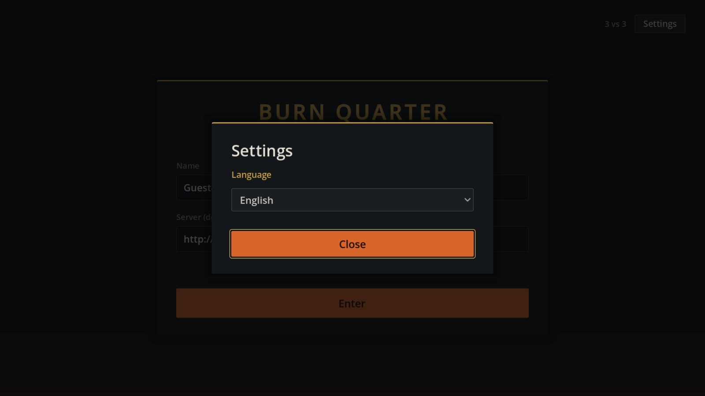

# 설정: 언어

로비 화면(입장·방 목록·방) 오른쪽 위 **설정**(영어로는 **Settings**) 버튼이 설정 창을 엽니다. 바꾼 값은 바로 적용되고 `user://settings.cfg`(Windows는 `%APPDATA%\Godot\app_userdata\Burn Quarter\settings.cfg`)에 저장되어 다시 켜도 유지됩니다. 처음 실행하면 시스템 언어와 상관없이 **영어**로 시작합니다. 게임에 소리가 없어 음량 설정은 없습니다. 경기 중에는 설정 창이 없습니다.



- 닫기 버튼, Esc, 창 바깥 클릭으로 닫습니다.
- 저장과 적용은 자동 로드 `Settings`(`settings/Settings.cs`)가 맡고, 창은 `lobby/SettingsPanel.cs`입니다. `Lobby`·`Room`이 `SettingsPanel.Attach(this)`로 머리줄에 버튼을 붙입니다.
- `Settings`는 자동 로드 맨 앞이라, 다른 자동 로드(`MatchSession`의 기본 이름 `Guest1234` 등)도 고른 언어로 시작합니다.

## 언어

English(기본)와 한국어 중에서 고릅니다. 고르는 즉시 열려 있는 로비·방 화면의 글자가 바뀝니다.

### 번역 방식

- Godot `TranslationServer`와 gettext PO 파일을 씁니다. 코드에는 지금처럼 **한국어**를 쓰고 `Lang.T("방 목록")`·`Lang.F("{0}초 후 시작", n)`으로 감싸며(`settings/Lang.cs`), `locale/en.po`에 그 한국어를 `msgid`로, 영어를 `msgstr`로 적습니다. 원문이 한국어라 `ko.po`는 없고, `project.godot`의 대체 로케일(`internationalization/locale/fallback`)을 `ko`로 두어 영어가 없는 문장은 한국어 그대로 나옵니다.
- 같은 한국어가 영어에서 둘로 갈리면 문맥을 붙입니다: `Lang.T("입장", "lobby")` = Enter, `Lang.T("입장", "room")` = Join (`msgctxt`).
- 컨트롤이 자기 글자를 스스로 번역하는 Godot 자동 번역은 루트에서 껐습니다. 번역은 `Lang`을 거친 곳에서만 일어나므로, 플레이어·방 이름이 번역 문장과 같아도 그대로 보입니다.
- 화면은 `Settings.LanguageChanged`를 받아 한 번만 넣는 글자(`ApplyText`)를 다시 넣고 `Refresh`합니다. 매 갱신마다 글자를 다시 만드는 곳은 따로 할 일이 없습니다.
- 용어는 상점 페이지 영어를 따릅니다: 대표 = Director, 용병 = Mercenary, 마석 = Mana Stone. 지역은 Korea·US·Germany·Australia입니다. 경기 화면의 `지휘관`도 같은 자리라 Director, 영웅 = hero이고, 경기 중 `용병`(인력 사무소·공장에서 뽑는 병력)도 한국어처럼 mercenary입니다.
- 건물 영어 이름은 [건물 문서의 추천 이름](../buildings/README.md#영어-이름-추천)을 따르고(브랜치 = Supply Depot, 숙소 = House, 인력 사무소 = Barracks, 비허가 실험실 = Forge, 감시탑 = Watchtower, 시추탑 = Oil Derrick), HQ는 두 언어 모두 HQ입니다. 표에 없는 건물·유닛·스킬 이름은 `locale/en.po`의 이름 묶음에 있습니다.
- 한 번만 넣는 글자를 다시 넣을 일은 로비 화면에만 있습니다. 설정 창은 로비에만 있어 경기 중에는 언어가 바뀌지 않으므로, 경기 HUD는 만들 때 한 번 번역하면 됩니다.

### 번역한 범위

| 범위 | 상태 |
| --- | --- |
| 입장·방 목록·방·로딩·경기 결과 화면 (`lobby/`) | 번역함 |
| 로비 세션 안내와 재접속 화면, `방으로 나가기` 버튼 (`network/MatchSession.cs`), 게임 서버 연결 오류 (`network/NetClient.cs`) | 번역함 |
| 로비가 보내는 거절 (`MatchSession.Describe`) | 오류 코드로 번역함. 모르는 코드는 로비 문장 그대로 |
| 로비가 보내는 지역 이름, 방 화면의 용병 이름 | 알려진 이름만 번역함 (`en.po`) |
| 경기 중 HUD: 명령창·선택 정보·미니언 편성·영웅 스킬과 상점·팀 창·관전 창·마석·건설 배치·유닛/건물 이름과 설명·스킬 설명, 맵 확인 문구와 맵 동기화 오류(로딩 화면에도 나옴) (`ui/`, `game/Main.cs`, `units/`, `buildings/`, `input/`, `maps/`, `events/`) | 번역함 |
| 서버가 보내는 문장: 경기 중 `ERR` 거절(건설·구매·편성 등), 방 채팅의 회색 안내 줄(입장·방장 변경·카운트다운 등), 상점의 아이템 이름과 설명(`ITEM_CATALOG`) | 한국어 그대로. 바꾸려면 서버가 코드나 키를 보내도록 프로토콜을 바꿔야 함 |
| 맵 파일의 라인 이름(`maps/test.json`의 `top`·`bottom`) | 맵 데이터 그대로 |
| 개발용 경고(`GD.PushWarning`·`GD.Print`) | 한국어 그대로 |

한국어 문구를 비교하는 검사(`CommandPanelChecks`, `SelectionDetailsChecks` 등)는 기대값도 `Lang.T(...)`·`Lang.F(...)`로 만들어, 플레이어의 `settings.cfg`가 어느 언어든 통과합니다.

## 새 문장 넣기

1. 코드에 한국어로 쓰고 `Lang.T`나 `Lang.F`로 감쌉니다. 숫자·이름은 `{0}` 자리로 넘깁니다(문장 안에서 이어 붙이지 않음).
2. `locale/en.po`의 해당 화면 묶음에 `msgid`(코드와 똑같은 한국어)와 `msgstr`(영어)을 더합니다. 줄바꿈은 `\n`입니다. 주석에 `fuzzy`라는 단어를 쓰면 Godot가 다음 항목을 건너뛰므로 쓰지 않습니다.
3. 변수로 넘기는 문장(지역·영웅 이름, `NetClient`의 연결 오류처럼 호출 자리에 글자가 없는 것)은 `tests/SettingsChecks.cs`의 `Indirect`에도 적습니다.

## 확인

`./tests/run.ps1 -Check SettingsChecks`가 서버 없이 처음 실행 기본값(영어), 언어 변경 알림, 저장 후 다시 읽기(재시작), 잘못된 파일의 기본값 복귀, 로비 화면의 설정 버튼·창과 언어 즉시 반영을 확인합니다. 소스의 `Lang.T`·`Lang.F` 문장과 `Indirect` 목록이 모두 `en.po`에 영어를 가지고, `{0}` 같은 자리를 그대로 지키는지도 봅니다. 검사는 `user://settings-checks.cfg`만 쓰고 플레이어의 `settings.cfg`는 건드리지 않습니다.

```powershell
& $env:GODOT_BIN --path . --resolution 1600x900 res://tests/SettingsChecks.tscn -- --capture
```

위 실행은 같은 검사를 화면 렌더로 돌리며 설정 창을 `docs/images/lobby-settings.png`에 저장합니다.
