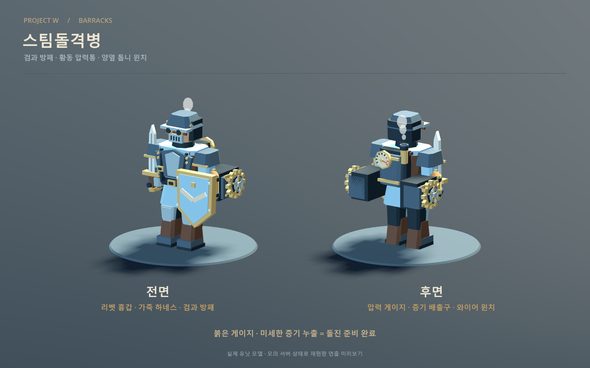
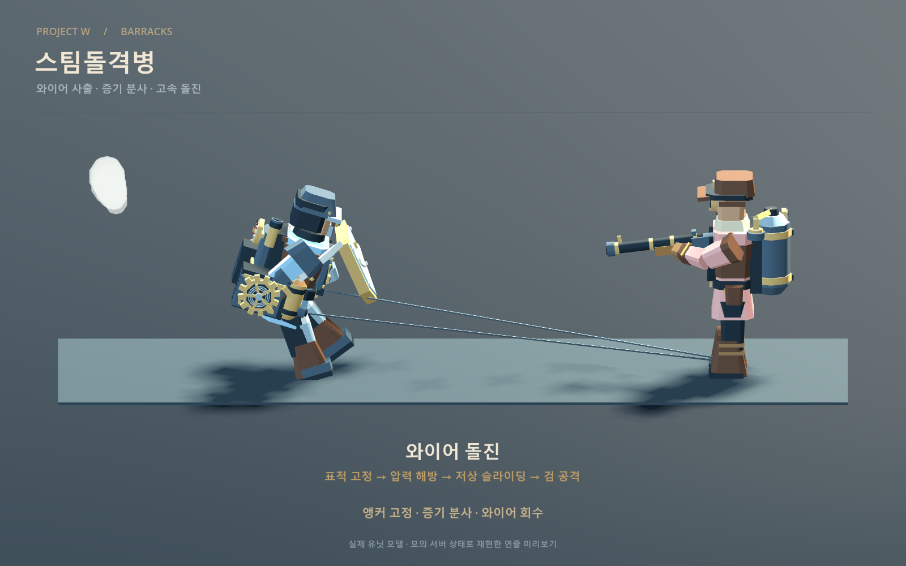
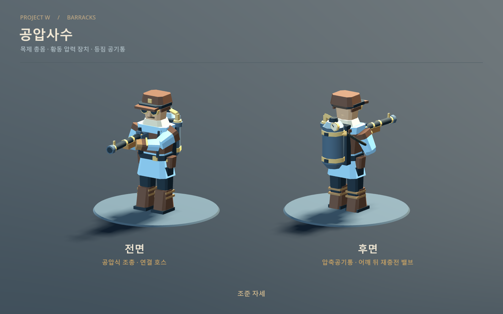

# 서버가 생성하는 유닛

- `units/Worker.tscn`: 타입 0. 작업복, 모자, 배낭, 벌목용 도끼가 있는 임시 일꾼 모델.
- `units/Knight.tscn`: 타입 1. 1티어 RTS 스팀돌격병. 펠트 제복·가죽 하네스 위의 리벳 흉갑과 무릎 보호대, 검과 방패, 양옆 황동 압력통·톱니 윈치, 등 뒤 증기 배출구·압력계.
- `units/Archer.tscn`: 타입 2. 1티어 RTS 공압사수. 목제 공압식 조총, 황동 압력 장치, 등짐 압축공기통, 연결 호스.
- `units/MinionKnight.tscn`: 타입 100. 근접 라인 미니언. 소유자는 0입니다.
- `units/MinionArcher.tscn`: 타입 101. 원거리 라인 미니언. 소유자는 0입니다.
- `units/HeroTest.tscn`: 타입 200. 첫 영웅인 돌연변이 늑대. 네 다리와 오른쪽의 작은 팔 하나, 굽힌 손목과 세 갈래 발톱을 가진 독립 모델·초상화를 사용합니다. 서버 호환을 위해 씬 경로와 타입 번호는 유지합니다.
- `previews/Units.tscn`: 세 모델을 서버 없이 확인하는 장면. Godot에서 열고 F6.
- `previews/TierOneUnits.tscn`: 미니언과 RTS 유닛을 동일 배율로 비교하는 장면. 1/2/3 시점, T 진영 색상, R 회전.

모든 유닛 씬은 `units/Unit.tscn`을 기반으로 합니다. 공통 ID·위치 반영은 `units/Unit.cs`, 타입 번호와 이름은 `units/UnitCatalog.cs`, 외형은 각 씬의 `Visual` 아래에 있습니다. 새 모델이 생기면 `Visual` 아래만 바꾸면 됩니다. 루트 원점은 발밑, 정면은 -Z입니다.

크기 차이를 더 잘 구분하도록 미니언을 기준으로 유지하고, 스팀돌격병·공압사수의 기존 모델은 1.08배, 늑대·골렘 영웅은 1.18배로 표시합니다. 각 씬의 `Visual/Rig` 배율과 클릭 영역·선택 원·체력바 높이를 함께 맞췄습니다. 서버의 충돌 반지름·사거리·스킬 범위는 기존 값을 사용합니다.

서버 `unit_defs.go`의 `UnitKnight`·`UnitArcher`는 병영 유닛, `minion_defs.go`의 `UnitMinionMelee`·`UnitMinionRanged`는 미니언 전용 정의입니다. 정의 및 이동·공격 능력치 객체를 공유하지 않으므로 체력·공격력·사거리·속도·시야를 각각 조절할 수 있습니다. 미니언에는 생산·채집 능력이 없고 인구는 0입니다. 클라이언트도 소유자에 따라 같은 타입의 모델을 바꾸지 않고 각 타입에 대응하는 씬을 사용합니다.

영웅은 서버 `hero_defs.go`에 별도로 정의하며 번호는 200~299를 사용합니다. 현재 등록된 영웅은 200 한 종류입니다. 소유자 ID로 조종 권한을, 서버가 배정한 진영으로 아군·적군을 판단합니다. 체력·능력치는 HP/STATS를 그대로 반영하고 이동·공격·정지·홀드는 기존 명령을 사용합니다.

`Unit.cs`에는 이동 속도나 공격 판정을 넣지 않습니다. 서버의 X/Z 위치를 1.5틱(30Hz 기준 50ms) 지연 보간하고 행동 상태를 표시합니다. 스팀돌격병은 `SteamKnightAnimation.cs`, 공압사수는 `PneumaticRifleAnimation.cs`, 원거리 미니언은 `ArcherAnimation.cs`, 늑대 영웅은 `BeastAnimation.cs`가 표시 위치의 변화를 보고 걷고, 서버 타격번호가 바뀔 때 공격 동작을 재생합니다. 일꾼 외형의 애니메이션은 `WorkerAnimation.cs`가 맡습니다.

스팀돌격병의 **와이어 돌진**은 완공된 아군 기술연구소의 Q 연구로 해금하는 자동 패시브입니다. 연구 완료는 같은 팀의 기존 병력과 이후 생산한 병력에 적용됩니다. 실제 발동 거리·속도 배율·재사용 시간은 `KNIGHT_RESEARCH`에서 받고, 추격 중 적 유닛을 향한 발동 여부·이동·충돌·중단은 서버가 결정합니다. 별도의 유닛 스킬 버튼은 없습니다.

`KNIGHT_CHARGE`는 연구 적용 여부, 재사용 가능 틱, 돌진 시작·만료 틱, 표적 ID와 발사 당시의 고정 앵커 좌표를 전달합니다. 연구 전에는 장비를 저압 상태로 표시하고, 준비가 되면 등 뒤 압력계 바늘이 붉은 구역으로 움직이며 증기가 조금 샙니다. 새 돌진에서는 허리 윈치의 앵커·와이어와 짧은 압력 해제 소리, 흰 증기 구름을 표시하고 몸을 낮춘 채 이동합니다. 와이어 끝은 서버의 앵커 좌표에 고정되고 유닛의 실제 표시 위치가 접근하면서 길이가 짧아집니다. 클라이언트는 속도를 더하거나 적을 향해 경로를 예측하지 않습니다.

최초 수신이 이미 진행 중인 돌진이면 현재 자세·와이어만 복원하고 과거의 발사음과 초기 분출을 반복하지 않습니다. 중복 스냅샷은 새 효과를 만들지 않으며, 돌진 종료·중단·만료·HIDE·죽음 때 효과를 정리합니다. 시야에서 사라진 표적을 따라 와이어를 표시하지 않습니다. 일반 검 공격은 기존 서버 타격번호를 따릅니다.

`previews/SteamKnight.tscn -- --capture`는 전면·후면을, `-- --capture --charge`는 돌진 자세를 저장합니다. `-- --cycle`은 모의 서버 상태와 위치를 실제 유닛 표시 코드에 적용해 연속 프레임을 생성합니다. 이 미리보기는 전투 규칙 검증이 아닙니다. `tools/build_tier_one_units.gd -- --knight-only`와 `tools/BakeSelectionPortraits.tscn -- --knight-only`는 스팀돌격병 모델·초상화만 갱신하며 다른 병력 자산을 다시 저장하지 않습니다.





[와이어 사출·증기 분사·돌진 애니메이션](images/steam-knight-charge-cycle.gif)

공압사수는 새 ATTACK 타격번호마다 공기 분출·탄환·반동을 표시합니다. 곧바로 보조 손이 어깨 뒤의 공기통 밸브를 눌렀다가 총을 받치는 자세로 복귀합니다. 연결 호스는 공기통 출구와 총의 공기 주입구를 따라 휘며, 재장전은 수신한 STATS 공격 간격 안에 마칩니다. 최초 스냅샷의 과거 공격이나 같은 번호로 다시 발사하지 않습니다. 탄환은 화면 연출이며 피해·사거리·공격 주기를 판정하지 않습니다. 숨겨진 대상을 추적하지 않고 HIDE·죽음·씬 정리 시 효과를 제거합니다. 원거리 미니언은 기존 활·화살 동작을 사용합니다.

`previews/PneumaticRifle.tscn`은 실제 공압사수의 전면·후면과 반복 사격을 보여 줍니다. Space 발사, T 진영색, 1/2 시점으로 조작하며 `-- --capture`, `-- --capture --attack`, `-- --capture --reload`로 각 자세를 저장합니다. `-- --cycle`은 `.godot/pneumatic-rifle-cycle/`에 발사·밸브 재충전 연속 프레임을 생성합니다. 모델 재생성은 `tools/build_tier_one_units.gd -- --archer-only`, 공압사수 초상화 두 장만 갱신하려면 `tools/BakeSelectionPortraits.tscn -- --archer-only`를 사용합니다. `--ranged-only`는 원거리 미니언 초상화도 함께 갱신합니다.



[발사·공기통 재충전 애니메이션](images/pneumatic-rifle-cycle.gif)

늑대는 높은 어깨와 낮은 허리, 긴 주둥이, 송곳니, 황색 눈을 가진 회색 짐승입니다. 마른 상처 사이로 양쪽 옆구리의 갈비뼈와 오른쪽 어깨뼈·뒷다리뼈가 부분적으로 드러나 언데드 느낌을 냅니다. 얼굴 오른쪽에는 관자놀이·눈썹뼈·광대뼈가 살짝 드러나며 노란 눈은 유지합니다. 작은 팔은 오른쪽 옆구리에서 나와 바닥에 닿지 않으며 네 발만 보행에 사용합니다. Body·Head·Jaw·Tail·네 다리의 관절·ExtraArm을 나누어 호흡·보행·물기와 작은 팔의 움직임을 표시합니다. `tools/build_mutant_wolf.gd`를 실행하면 `units/models/MutantWolfRig.tscn`을 재생성하며 게임 중에는 메시를 만들지 않습니다. 클릭 영역은 외형에 맞췄지만 서버 충돌 반지름은 기존 0.5를 유지합니다.

스킬 입력·사거리·재사용 시간은 서버의 `ABILITY` 정의를 사용합니다. 적/아군 대상은 유닛과 건물, 지점 대상은 좌표, 자신 대상은 즉시 시전을 지원합니다. 늑대 Q는 `SKILL 0 대상ID`로 요청하는 물어뜯기입니다. `SKILL 시전자ID 0 대상ID`와 `STATE ... DASH ...`에 맞춰 몸을 낮추고 턱을 벌리며 실제 이동은 POS, 피해는 HP를 따릅니다. 공통 코드는 `ISkillPresentation`에 슬롯과 강화 여부를 전달합니다. 골렘은 `GOLEM id 강화대기(0|1)`로 R 준비 상태를 표시하고, `SKILL` 끝의 `EMPOWERED` 토큰으로 강화 Q/W/E 연출을 선택합니다. 따라서 준비 상태 해제 메시지의 도착 순서와 무관하게 강화 시전을 표현합니다. `CONTROL`의 기절·침묵은 스킬을 막고, 속박은 이동 스킬만 막습니다.

서버의 `UnitDef`·`BuildingDef`가 `Skills`, `StatProviders`, `Reactions`를 구성하고 `HeroDef`는 레벨 성장만 담당합니다. 능력치 보너스는 패시브 함수와 시한부 `ModifierDef`를 같은 계산식에 합산합니다. 각 효과에 시전자·스킬 출처가 남으므로 다른 플레이어의 버프도 독립적으로 적용·갱신·제거할 수 있습니다. 서버 README의 스킬 예제를 참고하세요. 일반 유닛·건물 시전은 서버의 `CAST` 경로를 지원하며 현재 클라이언트 스킬 패널은 조종 영웅용입니다.

`previews/MutantWolf.tscn`은 실제 영웅 씬을 세 시점으로 보여줍니다. Space 걷기, A 물기, Q 돌진 자세, R 회전, T 진영색 전환이며 `-- --capture`로 `docs/images/mutant-wolf.png`를 저장합니다. `-- --capture --skill`은 `.godot/mutant-wolf-skill.png`에 Q 자세를 저장합니다. 아군·적군 초상화는 `tools/BakeSelectionPortraits.tscn -- --hero-only`로 해당 두 장만 다시 만들 수 있습니다.

## 1티어 RTS 외형 기준

시야와 공격 사거리는 서버 `range.go`에서 몸 가장자리 사이의 거리로 계산합니다. 유닛은 `Radius`, 건물은 `Size`의 점유 영역을 사용하며 모델·무기·선택 원 크기는 포함하지 않습니다. 화면 시야도 서버의 `BODY`·`SIGHT` 정의와 인스턴스 `STATS`에 맞춥니다. [시야 거리와 표시](fog-of-war.md)를 참고하세요.

미니언 높이 약 2.0에 비해 스팀돌격병은 2.65, 공압사수는 2.67로 약 30% 크게 디자인했습니다. AOS 영웅은 추후 미니언 대비 약 1.65배를 기준으로 제작하며, 이번에는 영웅 모델을 추가하지 않습니다. 선택 영역과 체력바 높이는 외형에 맞추고, 루트 좌표와 서버 충돌 반지름은 확대하지 않습니다. `BodyRadius`는 서버의 스팀돌격병 0.5 / 공압사수 0.4와 맞춰 건설 배치 검사에 사용합니다.

`tools/build_tier_one_units.gd`는 `units/models/*Rig.tscn`을 생성하는 수동 도구입니다. 각 모델은 머리·몸통·양팔·양다리로 나뉘고, 부위마다 기본 색상과 진영 색상 표면을 합쳐 저장합니다. 게임 중 메시를 다시 만들지 않습니다. 초상화 갱신은 `tools/BakeSelectionPortraits.tscn -- --soldiers-only`, 비교 이미지 저장은 `previews/TierOneUnits.tscn -- --capture`로 실행합니다.

완성된 아군 병영을 선택하면 스팀돌격병(타입 1)과 공압사수(타입 2)를 생산할 수 있습니다. 두 유닛 모두 `Mover`, `Attack`, `Production` 능력을 가지며, 서버 TRAIN_DEF에서 받은 비용·인구·생산 시간을 사용합니다. 채집 능력은 없습니다. 병영 ID를 지정해 해당 건물의 독립 대기열에 예약하고 정면·양옆·뒤쪽 중 빈 자리에 생성합니다. 미니언은 기존 웨이브에서 생성하며 플레이어의 인구를 차지하지 않습니다. [생산 요청과 표시](command-panel.md)를 참고하세요.

## 메시지

```text
WELCOME 플레이어ID 진영 COMMANDER
WELCOME 플레이어ID 진영 HERO 영웅종류
TICK 틱번호
UNIT 타입 유닛ID 소유자ID X Z 진영
POS 유닛ID X Z
STATE 유닛ID또는건물ID IDLE|GUARD|HOLD|GATHER|ATTACK|BUILD|DASH|STUN 운반량 대상ID 타격번호 [운반자원종류]
ABILITY UNIT|BUILDING 타입 슬롯 스킬ID ENEMY|ALLY|POINT|SELF 사거리 쿨다운초 이동여부
SKILL 시전자ID 슬롯 [대상ID | X Z]
COOLDOWN 시전자ID 슬롯 재사용가능틱
KNIGHT_RESEARCH 진영 해금여부 연구소ID 남은시간 전체시간 목재비용 기름비용 연구시간 발동거리 속도배율 재사용시간
KNIGHT_CHARGE 유닛ID 적용여부 재사용가능틱 시작틱 만료틱 대상ID 앵커X 앵커Z
CONTROL 유닛ID 행동제한플래그
SHIELD 유닛ID또는건물ID 남은보호막
MANA 영웅유닛ID 현재마나 최대마나
MANA_COST 영웅타입 슬롯 마나비용
TEAM_RESPAWN 플레이어ID 부활틱
CONSTRUCTION 건물ID 진행률 비용지불자ID
QUEUE 건물ID 생산진행률 예약ID:유닛타입:주인ID ...
REMOVE 유닛ID또는건물ID
HIDE 유닛ID
BUILDING_VISION 건물ID 0|1
```

Main은 UNIT/POS를 UnitManager로, STATE/HP/REMOVE는 UnitManager와 BuildingManager로, CONSTRUCTION은 BuildingManager로 전달합니다. STATE는 StateSnapshot에서 한 번 검증하고 ID가 등록된 관리자가 적용합니다. UnitManager는 UNIT을 받았을 때만 Main/Units 아래에 유닛을 만듭니다. 같은 ID는 중복 생성하지 않고 정보를 갱신합니다. 유닛 타입은 ID가 유지되는 동안 동일하다고 가정합니다.

STATE BUILD는 일꾼이 실제로 건물 옆에서 작업 중일 때만 보내며 대상ID는 건물ID입니다. 접근 중에는 IDLE입니다. 운반량과 타격번호는 기존 값이 남을 수 있으므로 0으로 강제하지 않습니다. 일꾼은 건물 쪽을 바라보며 공통 작업 애니메이션을 재생하고 선택 창에 `건설 중`을 표시합니다. 새 타격번호를 만들어 공사 진행률을 계산하지 않습니다.

## 이동 보간

서버는 매 틱 시작에 `TICK N`을 보내고 그 뒤 해당 틱의 변경된 `POS`와 상태를 보낸 다음 `TICK_END N`으로 완료를 알립니다. 클라이언트는 해당 틱의 완료 메시지를 받으면 위치를 확정하며, 다음 `TICK`도 앞 틱의 완료를 보장합니다. 현재 틱과 다른 번호·중복·잘못된 완료 메시지는 무시합니다. TCP 수신 큐가 비거나 렌더 프레임이 끝났다는 이유로 틱을 완성하지 않습니다. `POS`가 없는 유닛도 직전 서버 좌표를 기록하므로 정지 중에는 멈추고 다시 출발할 때 해당 구간만 보간합니다.

`network/InterpolationClock.cs`의 `TickRate = 30`, `DelaySeconds = .05`가 공통 재생 시점을 정합니다. 지연은 1.5틱입니다. 정상 수신 시 `TICK N` 도착 시점에는 N-1.5를 표시하고, 해당 틱이 완료되면 다음 약 33.3ms 동안 N-0.5까지 연속 보간합니다. 이는 수신한 서버 시간 기준 50ms이며 네트워크 전달 시간은 별도로 더해집니다. 완료 메시지가 늦으면 마지막 확정 위치에서 기다립니다. 작은 수신 간격 변동은 재생 속도 ±10%로 보정합니다. 확정된 마지막 위치를 넘어 예측하지 않고, 긴 지연 후 4틱 넘게 밀리면 최근 구간으로 복귀합니다. 유닛당 최근 8개 위치만 보관합니다.

UNIT 생성·재등장·중복 스냅샷은 즉시 배치하고 보간 이력을 새로 시작합니다. 첫 TICK 전의 POS도 즉시 반영합니다. HIDE/REMOVE는 즉시 처리하고 맵 재동기화·연결 종료 시 시계와 이력을 초기화합니다. 루트 위치를 보간하므로 선택 영역·체력바·대상 표시도 함께 움직이며, 안개와 미니맵은 보간 이동 때도 갱신됩니다.

이번 보간은 위치 표시에 적용합니다. STATE/HP·공격 연출·사망·시야 이탈은 수신 즉시 적용하므로 위치보다 정상 수신 시 약 50ms 먼저 보일 수 있습니다. 명령 전송은 지연하지 않으며 이동 예측·충돌·경로 계산은 클라이언트에 추가하지 않습니다. 서버 틱 주기를 변경하면 클라이언트의 `TickRate`도 함께 맞춰야 합니다. 이번 30Hz·50ms 설정은 서버와 클라이언트를 함께 갱신해야 합니다.

소유자 ID는 조종 권한, 진영은 아군/적군을 구분합니다. 소유자 0인 미니언도 시야 안에서는 클릭하여 정보를 볼 수 있지만 명령할 수는 없습니다. 전용 타입 100·101에 따라 MinionKnight/MinionArcher 씬으로 표시합니다. [미니언 동기화](minions.md)를 참고하세요.

의상·모자·방패의 `team_cloth` 재질은 내 진영을 기준으로 아군은 옅은 파랑, 적군은 옅은 붉은색으로 표시합니다. 미니언과 다른 플레이어의 유닛도 같은 진영이면 아군 색을 사용합니다. 원본 모델과 피부·금속·가죽·목재는 유지합니다. [진영 색상](team-colors.md)을 참고하세요.

REMOVE를 받으면 선택과 클릭 판정에서 즉시 제외하고, 모델은 공통 사망 연출(옆으로 넘어짐 → 서서히 사라짐)을 마친 후 지웁니다. 채집/공격 요청의 대상에는 각각 노란/빨간 원을 표시합니다. 자세한 동작과 미리보기는 [사망 연출과 명령 대상 표시](combat-feedback.md)를 참고하세요.

HIDE는 시야 이탈입니다. 사망 연출 없이 모델·클릭 영역·명령 대상 표시와 ID 조회를 즉시 정리합니다. 이후 UNIT/STATE/HP가 다시 오면 새 인스턴스로 최신 상태를 표시합니다. 시야 밖 상대 유닛은 처음부터 스냅샷에 포함되지 않습니다. 자세한 내용은 [전장의 안개](fog-of-war.md)를 참고하세요.

건물은 이동만 막고, 나무·벽만 시야를 차단합니다. 건물 위치는 처음부터 알려져 있지만 현재 아군 시야 밖의 적 건물은 조회·공격할 수 없습니다. `BUILDING_VISION`은 서버가 초기 스냅샷과 가시성 변경 때 보내는 현재 공개 여부입니다. 외벽 일부가 보이면 모델 전체를 밝히며 주변 지형의 시야는 확장하지 않습니다.

RTS에서는 내 유닛을 좌클릭하면 선택 원이 켜집니다. 좌클릭 드래그는 박스에 몸통 중심이 들어오는 내 유닛을 최대 64개 선택합니다. 새 선택은 기존 선택을 대체합니다. 빈 박스, 빈 곳 클릭, 다른 플레이어의 유닛 클릭은 선택을 해제합니다. 우클릭은 대상을 확인하여 MOVE, ATTACK, GATHER, RETURN 또는 CONSTRUCT를 요청합니다. 시추탑 채집은 선택한 내 일꾼들, 회관·보급기지 반납은 그중 자원을 든 일꾼들, 이어 짓기는 내 일꾼 한 명에게 보냅니다. RTS 유닛은 생성 시 자동 선택하지 않습니다.

STATE의 마지막 운반 종류는 목재 0·기름 2이며 이전 6필드 메시지는 목재로 처리합니다. 일꾼 외 유닛·건물에 기름 운반 상태가 오면 무시합니다. 일꾼의 자세와 소품은 [일꾼 애니메이션](worker-animation.md), 반복 채집과 직접 반납은 [조작 안내](controls.md#채집과-반납)를 참고하세요.

AOS에서는 WELCOME의 영웅 타입과 내 소유자·진영에 맞는 영웅 한 기를 UnitManager가 항상 선택 상태로 유지합니다. 클릭·드래그·Shift·초상화·부대 호출로 조종 대상이 다른 유닛이나 건물로 바뀌지 않으며 우클릭, A/S/D, 미니맵 명령을 모두 같은 영웅에게 보냅니다. 클릭한 유닛은 별도의 UnitInfoPanel에서 조회하며 이 대상은 명령 목록에 넣지 않습니다. 자원 우클릭도 이동으로 처리합니다. REMOVE/HIDE·소유권 상실 때 조종 선택을 비우고 이후 UNIT으로 내 영웅이 등장하면 다시 연결합니다. 역할을 RTS로 바꾸면 고정을 풀고 수동 선택으로 돌아갑니다.

PlayerInput은 UI에서 처리하지 않은 좌클릭으로 선택을 시작합니다. 6픽셀 이상 움직이면 드래그이며, 버튼을 뗄 때 단일 선택 또는 박스 선택을 확정합니다. 시작한 드래그는 UI 위에서 버튼을 떼어도 종료하고, Esc·우클릭·창 포커스 상실 시 취소합니다. SelectionBox는 입력을 가로채지 않고 화면에 박스만 그립니다.

광선과 박스 선택 요청은 같은 큐에 보관해 물리 프레임에서 순서대로 처리합니다. 선택용 Area3D는 충돌 레이어 2입니다. 소유권 확인과 선택 목록은 UnitManager가 담당하며, 유닛이 삭제되거나 소유자가 바뀌면 목록에서도 제외합니다. 우클릭 목적지는 Y=0 평면 기준이며 맵 경계·통행 가능 여부는 서버에서 검사합니다.

UnitManager는 NetClient를 직접 참조하지 않습니다. MOVE/ATTACK/GATHER/BUILD/CONSTRUCT 문자열을 만든 뒤 CommandRequested 이벤트로 전달하면 Main이 전송합니다. 씬의 유닛 리소스와 카메라는 Units 노드의 인스펙터에 연결되어 있습니다.

## 공격 요청 (클라이언트 → 서버)

```text
ATTACK 대상ID 내유닛ID...
ATTACK 202 101 303
```

위 예시는 선택한 101, 303번 유닛에게 202번 유닛 또는 건물을 공격하도록 요청합니다. `NetClient.Send`가 줄바꿈을 붙입니다. 선택 상한은 이동과 동일하게 64개입니다. 서버는 대상 존재 여부, 공격 가능 여부, 명령을 보낸 플레이어의 유닛 소유권을 검증합니다. 공격·추적·피해는 서버에서 계산하고 클라이언트는 결과를 표시합니다. STATE의 대상 ID는 유닛·건물·자원 목록에서 조회합니다.

사거리 안에서 공격하는 유닛은 다음 공격을 기다리는 동안에도 아군에게 밀리지 않고 자리를 지킵니다. 다가오는 아군은 공격자의 몸을 통과하지 않고 옆으로 돌아갑니다. 같은 진영의 미니언과 다른 플레이어 유닛에도 적용하며, 이동 명령을 받거나 적을 추격할 때, 공격 대상이 없어졌을 때는 고정을 해제합니다. 충돌과 우회는 서버에서 처리하고 클라이언트는 기존 POS/STATE 메시지로 표시합니다.

적 우클릭과 기본 패널의 A → 적 좌클릭은 같은 요청을 보내며 선택 목록은 유지합니다. 서버가 보낸 진영이 다르면 적으로 판단합니다. 같은 진영의 미니언·다른 플레이어의 유닛·건물은 아군입니다. A 모드는 클릭 한 번으로 종료하며, 빈 땅 클릭은 `ATTACK_MOVE X Z 내유닛ID...`, 아군 클릭은 명령 없이 종료합니다. Esc 또는 창 포커스 상실로 취소할 수 있습니다. A 모드에서 우클릭하면 모드를 종료하고 일반 우클릭 동작(적 공격/아군 공사 이어 짓기/나무 채집/땅 이동)을 수행합니다. 선택한 유닛이 없거나 대상이 삭제되었으면 공격 요청을 보내지 않습니다. 일꾼의 1티어 메뉴가 열려 있을 때 A는 병영 선택에 사용합니다.

## 검증

검증: `./tests/run.ps1 -Suite Units`. [필수 테스트 안내](../tests/README.md).

검증 장면은 실제 서버에 접속하지 않고 UNIT/POS/REMOVE 메시지를 전달합니다.

## 일반 우클릭과 채집

PlayerInput의 `ContextClicked(Node3D target, Vector3 point)` 이벤트를 Main에서 `Units.RequestContextOrder`에 연결합니다. 대상은 Unit, Building, ResourceNode, 또는 null(땅)입니다. 우클릭은 유닛·건물·자원의 클릭 레이어를 한 번에 광선 조회하므로 화면에서 먼저 닿은 대상을 사용합니다. 좌클릭 선택과 A 공격 지정은 유닛·건물을 함께 조회합니다. 건물 좌클릭은 유닛 선택을 해제하고 건물 체력을 표시합니다.

```text
PlayerInput.HandleRightClick
 → ContextClicked?.Invoke(target, point)
 → UnitManager.RequestContextOrder
   - 적 유닛 / 적 건물 → RequestAttack
   - 아군 미완성 건물 + 선택한 내 일꾼 → RequestConstruct (한 명)
   - 나무 → RequestGather
   - 땅 / 아군 유닛 / 그 밖의 아군 건물 → RequestMove
 → CommandRequested
 → Main.SendCommand
```

`+=`는 이벤트에 실행할 함수를 등록하고, `Invoke`는 등록된 함수들을 호출합니다. `?.Invoke`는 등록된 함수가 없으면 건너뜁니다. 이벤트 자체가 별도 스레드를 만들지는 않으며, 현재는 물리 프레임에서 광선 조회를 마친 자리에서 연결된 함수를 실행합니다.

```text
GATHER 자원ID 내유닛ID...
GATHER 9900 808 809
```

선택한 유닛이 없거나 자원이 삭제·소진되었으면 보내지 않습니다. 혼합 선택은 선택한 내 유닛 ID를 그대로 보내고, 서버가 소유권·채집 능력·이동 능력·대상 자원을 검사합니다. 클라이언트에서 자원량을 예측해 깎지 않으며 기존 TREE 메시지로 화면을 갱신합니다.

## 건설과 이어 짓기

정지·홀드는 각각 `STOP 유닛ID...`, `HOLD 유닛ID...`로 요청합니다. 서버의 각 유닛 현재 위치에서 기존 작업을 중단하고, 정지는 추격 가능한 경계, 홀드는 추격 없는 위치 사수를 시작합니다. 운반 자원과 공사 부지는 유지하고 환급하지 않습니다. [버튼과 단축키](command-panel.md#공격정지홀드)를 참고하세요.

내 일꾼을 선택하고 Z / 넘패드 1 위치의 `1티어` 버튼을 누르면 건설 메뉴를 엽니다. Q 보급기지(store, 타입 2), W 주택(supply, 3), E 시추탑(oil_derrick, 7), A 병영(barracks, 4), S 대장간(forge, 5), D 망루(tower, 6)를 선택할 수 있습니다. 회관은 타입 0, 시작 요새는 1입니다. 메뉴와 배치 취소는 [명령 패널](command-panel.md), 점유 검사는 [건설 배치](../buildings/README.md#건설-배치)를 참고하세요.

```text
BUILD 건물타입 x z 일꾼ID
CONSTRUCT 건물ID 일꾼ID
CANCEL_BUILD 건물ID
CANCEL_TRAIN 건물ID 예약ID
```

BUILD는 선택한 내 일꾼 중 ID가 가장 작은 한 명을 사용합니다. 서버는 일꾼이 도착했을 때 자리와 비용을 다시 확인하고, 비용을 지불한 뒤 BUILDING과 CONSTRUCTION 0을 보냅니다. 아직 이동 중인 건설 요청은 실제 건물로 표시하지 않습니다.

내 일꾼을 선택하고 같은 진영의 미완성 공사 부지를 우클릭하면 CONSTRUCT를 요청합니다. 다중/혼합 선택에서도 ID가 가장 작은 내 일꾼 한 명만 보내고 다른 선택 유닛의 명령은 바꾸지 않습니다. 같은 편 건물에는 다른 플레이어 소유 건물도 포함하지만, 다른 플레이어 소유 일꾼을 직접 명령할 수는 없습니다. 완성 건물이나 일꾼 없는 아군 건물 우클릭은 기존 이동입니다.

건설자는 건물당 한 명입니다. 서버는 아직 부지로 접근 중인 건설자도 예약하므로 클라이언트는 공사 진행률이 멈췄다는 이유로 건설자가 없다고 판단하지 않습니다. 다른 일꾼이 배정되어 있으면 `ERR 이미 짓는 중`을 알리고, 같은 일꾼의 재요청은 허용합니다. 이어 짓기는 추가 비용이 없습니다.

공사 부지는 공통 테두리와 팻말로 표시합니다. CONSTRUCTION의 정수 0~100을 서버가 보낸 만큼만 갱신하고 100에서 완성 모델을 보여줍니다. 별도 중단 메시지는 없으며 일꾼이 다른 명령을 받거나 죽으면 진행률이 멈춥니다. 건물 REMOVE는 공사 부지와 대상 조회를 즉시 지우고, 일꾼은 후속 서버 STATE IDLE에서 작업을 멈춥니다. 공사 중 방어시설은 서버 사격과 클라이언트 발사 연출이 모두 차단됩니다.

건설 비용·시간·체력은 서버 `building_defs.go`를 따릅니다. 보급기지는 `Store.tscn`과 타입 2를 유지하며, 회관보다 한 칸 작은 4×4입니다. 완공된 보급기지는 같은 팀 일꾼의 목재·기름 반납 거점으로 사용됩니다. 기름은 완성된 시추탑에서 채집하며 회관 업그레이드에 사용합니다.

일반 이동 명령을 완료한 플레이어 유닛은 도착 지점 주변을 자동 경계합니다. 시야 안의 적을 공격하고, 적이 경계 범위(시야와 10 중 작은 값)를 벗어나거나 사라지면 도착 지점으로 돌아옵니다. 이동 중에는 적을 쫓지 않으며 새 이동·공격·채집·건설 명령이 경계보다 우선합니다. 기존 미니언의 라인 이동과 공격 이동 명령은 유지합니다.
